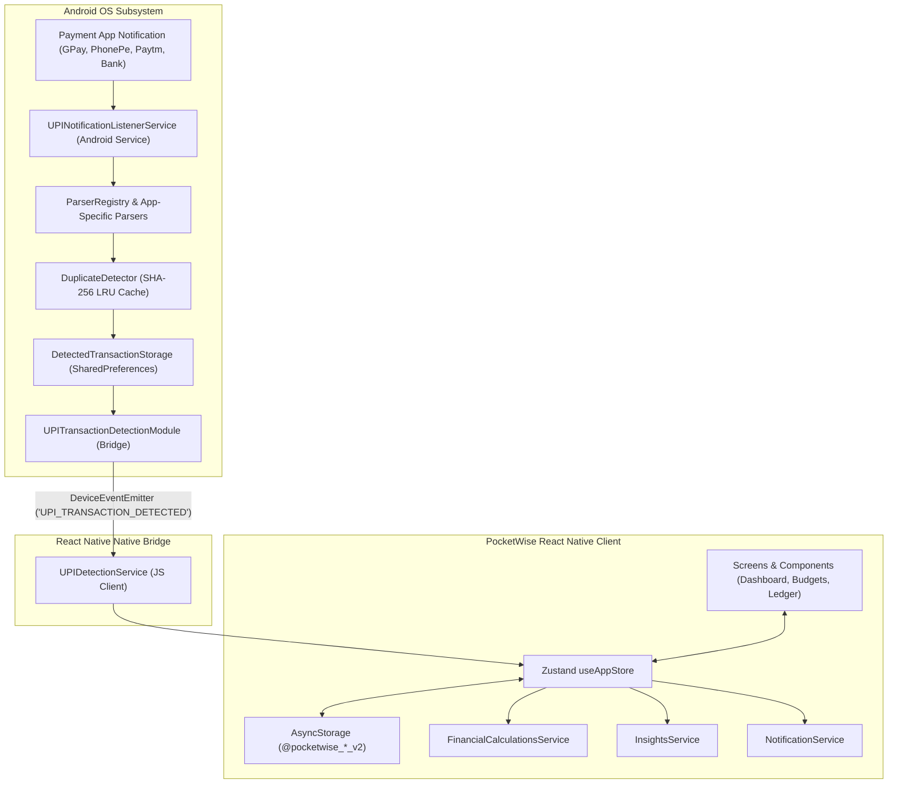

# Phase 1: Project Overview — PocketWise

## 1. Application Name & Purpose

**PocketWise** (`com.taha_911.pocketwise`, version 1.0.0) is an offline-first, privacy-focused mobile personal finance manager, wealth tracker, and automated expense intelligence system built with React Native and Expo SDK 57.

The application enables individuals to take total control of their financial life by recording day-to-day expenses, monitoring multi-account balances, allocating capital toward defined savings targets, maintaining category budgets, scheduling recurring commitments, and automatically capturing UPI payment notifications directly on Android devices without third-party cloud intermediation or bank credential scraping.

---

## 2. Business Objectives & Problems Solved

| Problem Identified in Personal Finance | PocketWise Solution | Codebase Implementation |
| :--- | :--- | :--- |
| **High Friction in Manual Expense Tracking**: Users forget to log micro-transactions (tea, groceries, cabs), causing tracking fatigue. | On-device Automatic UPI Transaction Detection engine that intercepts payment notifications and converts them into transactions with 1 tap. | `UPINotificationListenerService.kt`, `MerchantCategorizer.kt`, `useAppStore.ts` (`processIncomingDetectedTransaction`) |
| **Fragmented Account Balances**: Money is split across cash, primary salary accounts, digital wallets, and credit cards with negative balances. | Unified multi-account balance aggregator with automated debit/credit balancing and internal account-to-account transfers. | `useAppStore.ts` (`addTransaction`, `transferBetweenAccounts`), `BalanceCard.tsx`, `AccountsScreen.tsx` |
| **Overspending Without Early Warnings**: Budgets are reviewed only at month-end when overspending has already occurred. | Real-time category budget monitoring with proactive 80% threshold warnings and instant alerts. | `FinancialCalculationsService.calculateBudgetPerformance`, `BudgetsScreen.tsx`, `NotificationService.ts` |
| **Unfocused Savings Goals**: Users save leftover funds irregularly rather than targeting milestones with required monthly quotas. | Goal-driven savings vaults with dynamic calculation of remaining months and required monthly contributions. | `FinancialCalculationsService.calculateGoalMetrics`, `SavingsScreen.tsx`, `AddGoalFundsModal.tsx` |
| **Late Fees on Recurring Bills & Subscriptions**: Unmonitored renewals lead to forgotten subscriptions and overdue utilities. | Dedicated recurring payment tracker with customizable advance reminder alerts and one-tap instant expense recording. | `RecurringScreen.tsx`, `UpcomingPaymentCard.tsx`, `NotificationService.ts` |
| **Financial Privacy Concerns**: Users distrust cloud apps that upload bank SMS, transaction histories, or account numbers to external servers. | 100% offline-first architecture. All records stay in local device storage (`AsyncStorage` and Android `SharedPreferences`). | `StorageService.ts`, `DetectedTransactionStorage.kt`, `ExportImportService.ts` |

---

## 3. Target Users and User Roles

### Target Audience
1. **UPI & Digital Payment Power Users**: Individuals conducting multiple daily digital payments via Google Pay, PhonePe, Paytm, BHIM, Amazon Pay, CRED, and banking apps.
2. **Budget-Conscious Individuals & Students**: Users looking to stick to fixed category allowances (Food, Transport, Entertainment) each month.
3. **Salaried Professionals & Freelancers**: Users with distinct income streams managing tax, emergency funds, and investment allocations.
4. **Privacy-Conscious Savers**: Users who demand complete data sovereignty without sharing financial logs with third-party cloud platforms.

### User Roles
- **Single-User Local Client Model (User/Owner)**: PocketWise operates as a standalone local client app. There is no remote multi-tenant backend, administrative portal, or role hierarchy. The user holds complete administrative ownership over all local records, configuration toggles, and data export/reset operations.

---

## 4. Main Features and Modules

```
PocketWise Core Modules
├── 1. Onboarding & Guided Personalization
├── 2. Executive Financial Dashboard
├── 3. Transaction Management & Ledger
├── 4. Automatic UPI Expense Detection (Android Native)
├── 5. Category Budgeting & Overspending Alerts
├── 6. Savings Goals & Wealth Vaults
├── 7. Recurring Bills & Subscription Tracker
├── 8. Financial Calendar & Daily Activity Map
├── 9. Financial Analytics & Cash Flow Reports
├── 10. Multi-Account & Balance Management
├── 11. Rule-Based Financial Insights Engine
└── 12. Backup, Migration & Data Sovereignty (JSON/CSV)
```

1. **Onboarding & Walkthrough Module**: 4-stage feature showcase, user personalization (name, currency, income range, savings goal target), initial account setup, and an interactive 9-step guided walkthrough modal.
2. **Executive Financial Dashboard**: Real-time net available liquid balance, month-over-month growth metric, net savings rate, quick action launcher, monthly overview breakdown, and spending charts.
3. **Transaction Management Ledger**: Unified ledger supporting four transaction types (`expense`, `income`, `saving`, `transfer`), fuzzy search, type filtering, category filtering, detail inspection, duplication, and deletion with balance reconciliation.
4. **Automatic UPI Expense Detection (Android Native)**: On-device `NotificationListenerService` parsing Google Pay, PhonePe, Paytm, BHIM, CRED, Amazon Pay, and major Indian bank notifications (HDFC, SBI, ICICI, Axis, Kotak, Samsung Wallet) with deduplication and auto-categorization.
5. **Budgets & Limit Governance**: Monthly and weekly category spend limits with live progress bars, 80% warning thresholds, and over-budget notifications.
6. **Savings Goals & Capital Allocation**: Dedicated savings targets calculating required monthly contribution rates based on target completion dates, supporting deposits and withdrawals.
7. **Recurring Payments & Subscription Engine**: Active recurring payments list, next due date calculation, advance reminder generation, and instant "Pay Now" ledger logging.
8. **Financial Calendar**: Interactive monthly calendar grid mapping transactions with color-coded day markers (expense, income, savings) and daily ledger inspection.
9. **Analytics & Cash Flow Reporting**: Time-series reports (7d, 30d, 3m, 6m, 1y), net savings calculation, opening vs. closing cash flow balances, and visual category distribution bars.
10. **Multi-Account Manager**: Management of Bank, Cash, Credit Card, Digital Wallet, and Investment accounts with real-time balance tracking and account-to-account transfer transactions.
11. **Rule-Based Insights Engine**: Deterministic financial intelligence evaluating spending trends, top category impacts, savings rate thresholds, and 20% smart-saving suggestions.
12. **Data Export & Import Service**: Lossless JSON data backup generation, standard CSV transaction exports, and JSON schema validation for backup restoration.

---

## 5. Technology Stack Summary

| Layer | Technologies / Packages | Version / Specifications |
| :--- | :--- | :--- |
| **Mobile Core** | React Native, React, Expo SDK | RN 0.86.3, React 19.2.3, Expo SDK 57.0.27 |
| **Navigation** | React Navigation (Native Stack + Bottom Tabs) | `@react-navigation/native` 7.5.0, `native-stack` 7.20.0, `bottom-tabs` 7.20.0 |
| **Native Android** | Kotlin, AndroidX Core, Notification Listener API | Android SDK 34 / 35, `NotificationListenerService`, `SharedPreferences` |
| **Expo Config Plugins** | `@expo/config-plugins` | Custom plugin `./plugins/withUpiDetector.js` injecting native Java/Kotlin files & permissions |
| **State Management** | Zustand | `zustand` 5.0.15 (Atomic store, unified actions, manual hydration) |
| **Client Storage** | AsyncStorage (JS) & SharedPreferences (Android) | `@react-native-async-storage/async-storage` 2.2.0, Mode Private SharedPreferences |
| **UI & Styling** | StyleSheet, Safe Area Context, Vector Icons, SVG | `react-native-safe-area-context` 5.7.0, `@expo/vector-icons` 15.0.2 (Feather), `react-native-svg` 15.15.4 |
| **Gestures & Animations** | Gesture Handler, Reanimated, Worklets | `react-native-gesture-handler` 2.32.0, `react-native-reanimated` 4.5.1, `react-native-worklets` 0.10.1 |
| **Testing** | Jest, ts-jest, React Native mocks | `jest` 29.7.0, `ts-jest` 29.4.14, 26 unit tests passing |
| **Deployment / Cloud** | Expo Application Services (EAS Build) | EAS Project `db6674ea-3c16-41da-8ece-8426af9a7ac9` |

---

## 6. Overall Application Architecture

PocketWise adopts a **Decoupled Offline-First Client Architecture** containing two cooperative layers:
1. **The React Native UI & Business Engine**: Manages user interactions, rendering, navigation, state storage (`useAppStore`), and derived financial calculations (`FinancialCalculationsService`, `InsightsService`).
2. **The Android Native Background Detection Service**: Operates autonomously in the Android OS layer via `UPINotificationListenerService`, parsing incoming status bar notifications, executing cryptographic deduplication, saving detected records in native storage, and streaming them to JavaScript via `RCTDeviceEventEmitter`.



---

## 7. High-Level System Architecture Diagram

```mermaid
flowchart TB
    subgraph Presentation_Layer ["Presentation Layer (React Native)"]
        Nav["RootNavigator / BottomTabNavigator"]
        Sc1["DashboardScreen"]
        Sc2["TransactionsScreen & Detail"]
        Sc3["BudgetsScreen"]
        Sc4["SavingsScreen"]
        Sc5["ProfileScreen & Settings"]
        Sc6["AccountsScreen"]
        Sc7["RecurringScreen"]
        Sc8["CalendarScreen"]
        Sc9["ReportsScreen"]
        Sc10["AutomaticDetectionSettingsScreen"]
    end

    subgraph State_And_Logic ["State & Business Logic Layer"]
        Store["Zustand Store (useAppStore.ts)"]
        CalcServ["FinancialCalculationsService"]
        InsServ["InsightsService"]
        NotifServ["NotificationService"]
        ExpImpServ["ExportImportService"]
        UPIServ["UPIDetectionService"]
    end

    subgraph Storage_Layer ["Data Persistence Layer"]
        AsyncStore[("@react-native-async-storage/async-storage\nJSON File Storage")]
        AndroidPrefs[("Android SharedPreferences\n'pocketwise_upi_storage'\n'pocketwise_dedup_cache'")]
    end

    subgraph Native_Android_Module ["Android Native Detection Engine"]
        Listener["UPINotificationListenerService"]
        Parsers["GooglePay / PhonePe / Paytm / Bank Parsers"]
        Dedup["DuplicateDetector (5-min hash window)"]
        Categorizer["MerchantCategorizer (Regex / Keyword DB)"]
        Bridge["UPITransactionDetectionModule"]
    end

    Nav --> Sc1 & Sc2 & Sc3 & Sc4 & Sc5 & Sc6 & Sc7 & Sc8 & Sc9 & Sc10
    Sc1 & Sc2 & Sc3 & Sc4 & Sc5 & Sc6 & Sc7 & Sc8 & Sc9 & Sc10 <--> Store
    Store <--> CalcServ & InsServ & NotifServ & ExpImpServ
    Store <--> UPIServ
    Store <--> AsyncStore
    UPIServ <--> Bridge
    Bridge <--> AndroidPrefs
    Listener --> Parsers --> Categorizer --> Dedup --> AndroidPrefs
    Dedup --> Bridge

