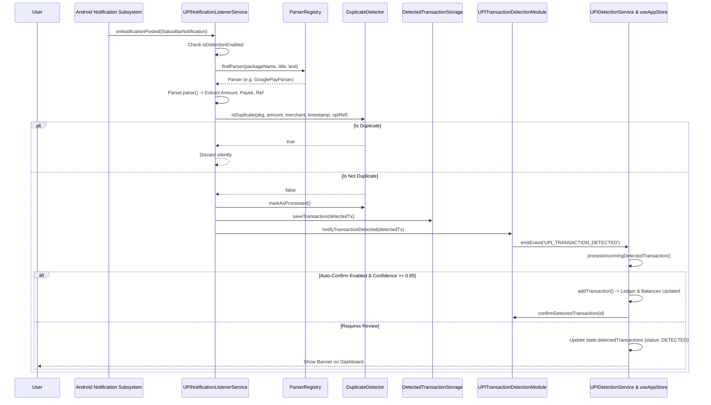

# Phase 2: Complete Feature Documentation — PocketWise

This document provides exhaustive, code-level documentation for every feature implemented in the PocketWise codebase. Every feature is traced from UI entry points through Zustand store actions, service logic, persistence models, and native Android hooks.

> [!NOTE]
> **Canonical Feature Index (19 Features: 16 Complete, 3 Partial)**  
> PocketWise features are grouped into 15 functional chapters in this guide, corresponding to the 19 canonical application capabilities detailed in [FEATURE-TRACEABILITY-MATRIX.md](file:///D:/Pocketwise/docs/FEATURE-TRACEABILITY-MATRIX.md):
> - **Features 1–11**: Chapters 1–11
> - **Features 12 & 13**: Chapter 12 (Multi-Account Management & Internal Transfers)
> - **Features 14 & 15**: Chapters 13 & 14 (AI Insights & Data Sovereignty)
> - **Features 16 & 17**: Chapter 15 (Theme/Currency Preferences & Local PIN Security)
> - **Features 18 & 19**: Partially implemented capabilities (Receipt Attachments & Custom Categories, detailed in [13-IMPLEMENTATION-AUDIT.md](file:///D:/Pocketwise/docs/13-IMPLEMENTATION-AUDIT.md))

---

## Feature 1: First-Time User Onboarding & Financial Personalization

### 1. Business Purpose
Guides first-time users through the core value propositions of PocketWise (Expense Tracking, Savings Goals, Financial Intelligence), captures their personal profile parameters (name, currency, monthly income bracket, savings target percentage), and bootstraps their initial financial account.

### 2. User Roles Who Can Access It
All unauthenticated / un-onboarded users where `settings.hasCompletedOnboarding === false`.

### 3. Entry Point
- **Route**: `Onboarding` in [RootNavigator.tsx](file:///D:/Pocketwise/src/navigation/RootNavigator.tsx#L38)
- **Screen**: [OnboardingScreen.tsx](file:///D:/Pocketwise/src/screens/onboarding/OnboardingScreen.tsx)

### 4. Complete User Workflow
1. User opens the application for the first time.
2. System detects `settings.hasCompletedOnboarding === false` and routes to `OnboardingScreen`.
3. User navigates through 4 feature slides (Welcome, Expense Tracking, Savings Goals, Financial Intelligence) via the "Next" button or taps "Skip".
4. On the final slide, the view transitions to the Personalization Form (`isPersonalizing = true`).
5. User enters:
   - Full Name / Display Name (`userName`)
   - Preferred Currency (Selected from `CURRENCY_OPTIONS`, defaulting to `INR` / `₹`)
   - Monthly Income Range (Selection chips: `< ₹25,000`, `₹25,000 - ₹50,000`, `₹50,000 - ₹1,00,000`, `₹1,00,000+`)
   - Primary Savings Goal (Selection chips: `Emergency Fund`, `Home / Vehicle`, `Vacation`, `Investment`, `Gadgets`)
   - Preferred Savings Target percentage (Slider/Chips: `10%`, `20%`, `30%`, `50%`)
   - Initial Account Name (defaults to `'Cash'`), Type (`bank`, `cash`, `credit`, `wallet`, `investment`), and Opening Balance.
6. User taps "Get Started".
7. System executes `completeOnboarding()` and `addAccount()`, updates `hasCompletedOnboarding: true`, and navigates to `MainTabs`.

### 5. Frontend Implementation
- Screen Component: `OnboardingScreen` in [OnboardingScreen.tsx](file:///D:/Pocketwise/src/screens/onboarding/OnboardingScreen.tsx)
- Reusable UI Components: `AppText`, `AppButton`, `AppInput`, `Feather` icons.
- Constants: `CURRENCY_OPTIONS` from [paymentMethods.ts](file:///D:/Pocketwise/src/constants/paymentMethods.ts).

### 6. Backend / Native Implementation
None (Local execution).

### 7. API / Store Actions Involved
- `useAppStore.completeOnboarding(data: Partial<UserSettings>)` in [useAppStore.ts](file:///D:/Pocketwise/src/store/useAppStore.ts#L845)
- `useAppStore.addAccount(account: Omit<Account, 'id'>)` in [useAppStore.ts](file:///D:/Pocketwise/src/store/useAppStore.ts#L510)

### 8. Database Tables & Models Involved
- `UserSettings` model saved to `@pocketwise_settings_v2`
- `Account` model saved to `@pocketwise_accounts_v2`

### 9. Business Logic & Validations
- Currency code is validated against `CURRENCY_OPTIONS`.
- Account opening balance is sanitized via `parseFloat(openingBalance.replace(/,/g, '')) || 0`.
- Account icon and color are automatically assigned based on the selected `AccountType`:
  - `bank`: icon `'credit-card'`, color `#0D9488`
  - `cash`: icon `'dollar-sign'`, color `#10B981`
  - `credit`: icon `'credit-card'`, color `#EF4444`
  - `wallet`: icon `'smartphone'`, color `#3B82F6`
  - `investment`: icon `'trending-up'`, color `#8B5CF6`

### 10. State Management & Data Flow
```
User Input -> OnboardingScreen State
   -> useAppStore.completeOnboarding() -> StorageService.setItem(@pocketwise_settings_v2)
   -> useAppStore.addAccount() -> StorageService.setItem(@pocketwise_accounts_v2)
   -> RootNavigator detects hasCompletedOnboarding === true -> Renders MainTabs
```

### 11. Notifications & Edge Cases
- If user leaves account name blank, defaults safely to `'Cash'`.
- If balance parsing fails or is empty, defaults to `0`.

### 12. Current Implementation Status
**Fully Implemented & Verified**.

---

## Feature 2: Interactive Product Walkthrough

### 1. Business Purpose
Provides a guided, step-by-step tour of the financial cockpit immediately upon first launch, highlighting available balance metrics, quick actions, transaction tracking, category budgets, savings goals, recurring bills, and AI insights.

### 2. User Roles Who Can Access It
Any user whose `settings.hasCompletedWalkthrough === false`. Can also be manually re-triggered anytime from Settings (`ProfileScreen`).

### 3. Entry Point
- Component: [WalkthroughModal.tsx](file:///D:/Pocketwise/src/components/modals/WalkthroughModal.tsx), rendered at the root of `RootNavigator` when `hasCompletedOnboarding === true`.
- Manual re-trigger: "Restart Product Walkthrough" button in [ProfileScreen.tsx](file:///D:/Pocketwise/src/screens/profile/ProfileScreen.tsx#L30).

### 4. Complete User Workflow
1. User finishes onboarding or taps "Restart Tour" in Profile.
2. `WalkthroughModal` renders over the current screen with a dimmed backdrop.
3. User progresses through 9 walkthrough cards:
   - Step 1: Welcome to PocketWise
   - Step 2: Available Balance & Net Worth
   - Step 3: Quick Actions
   - Step 4: Transaction Tracker
   - Step 5: Smart Category Budgets
   - Step 6: Savings & Emergency Fund
   - Step 7: Recurring Payments & Bills
   - Step 8: Financial Insights & Reports
   - Step 9: Ready to Go
4. User taps "Next" or "Previous" to cycle through steps, or taps "Skip Tour" / "Get Started" to dismiss.
5. System invokes `completeWalkthrough()`, persisting `hasCompletedWalkthrough: true` to `@pocketwise_settings_v2`.

### 5. Frontend Implementation
- Component: `WalkthroughModal` in [WalkthroughModal.tsx](file:///D:/Pocketwise/src/components/modals/WalkthroughModal.tsx).
- Insets handling: `useSafeAreaInsets` to ensure modal dialog fits comfortably on small screens.

### 6. Backend / Native Implementation
None (Client-side state only).

### 7. API / Store Actions Involved
- `useAppStore.completeWalkthrough()` in [useAppStore.ts](file:///D:/Pocketwise/src/store/useAppStore.ts#L857)
- `useAppStore.restartWalkthrough()` in [useAppStore.ts](file:///D:/Pocketwise/src/store/useAppStore.ts#L867)

### 8. Database Tables & Models Involved
- `UserSettings.hasCompletedWalkthrough` in `@pocketwise_settings_v2`.

### 9. Current Implementation Status
**Fully Implemented & Verified**.

---

## Feature 3: Executive Financial Dashboard & Real-Time Balance Overview

### 1. Business Purpose
Serves as the executive summary of the user's financial standing, displaying net liquid balance, month-over-month growth percentage, net savings rate, monthly income vs. expense comparisons, recent transactions, pending UPI detections, and quick action shortcuts.

### 2. User Roles Who Can Access It
All onboarded users.

### 3. Entry Point
- Tab: `Home` in [BottomTabNavigator.tsx](file:///D:/Pocketwise/src/navigation/BottomTabNavigator.tsx#L42)
- Screen: [DashboardScreen.tsx](file:///D:/Pocketwise/src/screens/dashboard/DashboardScreen.tsx)

### 4. Complete User Workflow
1. User navigates to Home tab.
2. System loads pre-calculated `overview` and `insights` from `useAppStore`.
3. `BalanceCard` displays:
   - Total Available Balance (sum of all liquid accounts).
   - Monthly Net Cash Flow growth badge (`monthOverMonthGrowth` %).
   - Net Savings Rate (`netSavingsRate` %).
   - Quick "Transfer" button opening `TransferModal`.
4. `QuickActions` component provides 1-tap buttons for:
   - `+ Expense`: Opens `AddTransactionModal` with `initialType = 'expense'`.
   - `+ Income`: Opens `AddTransactionModal` with `initialType = 'income'`.
   - `+ Saving`: Opens `AddTransactionModal` with `initialType = 'saving'`.
   - `⇄ Transfer`: Opens `TransferModal`.
5. `PendingDetectedTransactionsBanner` displays pending unconfirmed UPI payments if any exist.
6. `MonthlyOverviewCard` renders monthly cash flow with a visual ratio bar comparing Income vs. Expenses.
7. `SpendingChart` provides a 7-day bar chart visualization of recent daily expenditures.
8. `FinancialInsightCard` highlights high-priority tips, overspending alerts, and savings opportunities.
9. `CategoryBreakdown` displays top expense categories and percentage distribution.
10. `Recent Transactions` list displays the last 5 transactions with direct navigation to `TransactionDetailScreen`.
11. Pull-to-refresh triggers a 600ms refresh cycle.

### 5. Frontend Implementation
- Screen: [DashboardScreen.tsx](file:///D:/Pocketwise/src/screens/dashboard/DashboardScreen.tsx)
- Modular Widgets:
  - `BalanceCard` in [BalanceCard.tsx](file:///D:/Pocketwise/src/components/financial/BalanceCard.tsx)
  - `QuickActions` in [QuickActions.tsx](file:///D:/Pocketwise/src/components/financial/QuickActions.tsx)
  - `MonthlyOverviewCard` in [MonthlyOverviewCard.tsx](file:///D:/Pocketwise/src/components/financial/MonthlyOverviewCard.tsx)
  - `SpendingChart` in [SpendingChart.tsx](file:///D:/Pocketwise/src/components/financial/SpendingChart.tsx)
  - `FinancialInsightCard` in [FinancialInsightCard.tsx](file:///D:/Pocketwise/src/components/financial/FinancialInsightCard.tsx)
  - `SavingsGoalCard` in [SavingsGoalCard.tsx](file:///D:/Pocketwise/src/components/financial/SavingsGoalCard.tsx)
  - `UpcomingPaymentCard` in [UpcomingPaymentCard.tsx](file:///D:/Pocketwise/src/components/financial/UpcomingPaymentCard.tsx)
  - `CategoryBreakdown` in [CategoryBreakdown.tsx](file:///D:/Pocketwise/src/components/financial/CategoryBreakdown.tsx)
  - `TransactionItem` in [TransactionItem.tsx](file:///D:/Pocketwise/src/components/financial/TransactionItem.tsx)

### 6. Backend / Calculations Implementation
- [FinancialCalculationsService.ts](file:///D:/Pocketwise/src/services/financialCalculations.ts):
  - `calculateOverview(accounts, transactions, goals, monthDate)`: Aggregates current month income, expenses, savings, opening/closing balance, and month-over-month growth.
  - `calculateCategoryBreakdown(transactions, start, end)`: Groups expenses by category and computes percentage share.
- [NotificationService.ts](file:///D:/Pocketwise/src/services/notificationService.ts):
  - `checkAndGenerateNotifications()`: Evaluates active budget overruns, due recurring payments, and completed goal milestones.

### 7. Database Models Involved
- `FinancialOverview`, `Account[]`, `Transaction[]`, `Budget[]`, `SavingsGoal[]`, `RecurringPayment[]`.

### 8. Current Implementation Status
**Fully Implemented & Verified**.

---

## Feature 4: Transaction Ledger, Multi-Filter Search & History

### 1. Business Purpose
Provides a comprehensive financial ledger for searching, filtering, inspecting, duplicating, and maintaining all historical transactions across all account types.

### 2. User Roles Who Can Access It
All onboarded users.

### 3. Entry Point
- Tab: `Transactions` in [BottomTabNavigator.tsx](file:///D:/Pocketwise/src/navigation/BottomTabNavigator.tsx#L50)
- Screen: [TransactionsScreen.tsx](file:///D:/Pocketwise/src/screens/transactions/TransactionsScreen.tsx)

### 4. Complete User Workflow
1. User taps the "Transactions" tab.
2. System loads transactions sorted chronologically (most recent first).
3. Header displays total record count (`N records found`).
4. User can filter transactions using three simultaneous dimensions:
   - **Type Segmented Filter**: `All`, `Expenses`, `Income`, `Savings`.
   - **Category Horizontal Chip Bar**: `All` + dynamic list of active categories (`Food & Dining`, `Transport`, etc.).
   - **Search Input**: Live text search matching transaction `title`, `categoryName`, `notes`, or exact `amount`.
5. Tapping any transaction opens [TransactionDetailScreen.tsx](file:///D:/Pocketwise/src/screens/transactions/TransactionDetailScreen.tsx).
6. Floating/header `+` button opens [AddTransactionModal.tsx](file:///D:/Pocketwise/src/components/modals/AddTransactionModal.tsx).
7. If no transactions match filters, `EmptyState` component is rendered with a "Log Transaction" call-to-action.

### 5. Frontend Implementation
- Screen: [TransactionsScreen.tsx](file:///D:/Pocketwise/src/screens/transactions/TransactionsScreen.tsx)
- Reusable Components: `AppInput`, `EmptyState`, `TransactionItem`, `PendingDetectedTransactionsBanner`.

### 6. Logic & Validations
- Search matching uses `toLowerCase().trim()`.
- Filter conditions evaluate in a single-pass `useMemo` computation.

### 7. Current Implementation Status
**Fully Implemented & Verified**.

---

## Feature 5: Transaction Creation, Duplication, Deletion & Balance Reconciliation

### 1. Business Purpose
Allows users to manually create, duplicate, and delete transactions while ensuring mathematical consistency across all affected account balances and savings goal vaults.

### 2. User Roles Who Can Access It
All onboarded users.

### 3. Entry Point
- Modals: [AddTransactionModal.tsx](file:///D:/Pocketwise/src/components/modals/AddTransactionModal.tsx), [TransferModal.tsx](file:///D:/Pocketwise/src/components/modals/TransferModal.tsx)
- Screen: [TransactionDetailScreen.tsx](file:///D:/Pocketwise/src/screens/transactions/TransactionDetailScreen.tsx)

### 4. Complete User Workflow
#### Creation Workflow
1. User taps `+` button in Header or Quick Actions.
2. `AddTransactionModal` opens.
3. User selects Type: `Expense`, `Income`, or `Saving`.
4. User enters:
   - Amount (validated > 0)
   - Title / Merchant Description
   - Category (dynamically filtered by selected Type)
   - Account (selected from user's active accounts)
   - Payment Method (`UPI`, `Bank Transfer`, `Credit Card`, `Debit Card`, `Cash`, `Digital Wallet`)
   - Destination Goal (if Type is `'saving'`)
   - Notes & Recurring toggle
5. User taps "Save Transaction".
6. System executes `addTransaction()`, updates account balances, updates goal amounts if saving, recalibrates `overview` and `insights`, and persists to `AsyncStorage`.

#### Duplication Workflow
1. User opens `TransactionDetailScreen` and taps the "Copy" icon in the header.
2. System invokes `duplicateTransaction(id)`.
3. Creates an identical copy with a new unique ID, current timestamp, and logs it to ledger.

#### Deletion Workflow
1. User taps "Delete Transaction" in `TransactionDetailScreen`.
2. `ConfirmDialog` prompts: *"Are you sure you want to delete this transaction? This action will reverse the balance adjustment on your account."*
3. On confirmation, system invokes `deleteTransaction(id)`:
   - If `expense`: adds amount back to account (`acc.balance + amount`).
   - If `income`: deducts amount from account (`acc.balance - amount`).
   - If `saving`: adds amount back to account and deducts amount from linked `SavingsGoal`.
   - If `transfer`: adds amount to source account and deducts from destination account.
4. Screen navigates back to ledger.

### 5. Frontend Implementation
- [AddTransactionModal.tsx](file:///D:/Pocketwise/src/components/modals/AddTransactionModal.tsx)
- [TransactionDetailScreen.tsx](file:///D:/Pocketwise/src/screens/transactions/TransactionDetailScreen.tsx)
- [TransferModal.tsx](file:///D:/Pocketwise/src/components/modals/TransferModal.tsx)

### 6. Store Logic & Balance Reversal
Located in [useAppStore.ts](file:///D:/Pocketwise/src/store/useAppStore.ts#L279-L495):
- `addTransaction`: Auto-creates default Cash account if user has no accounts yet.
- `updateTransaction`: Performs two-phase balance reconciliation: first rolls back the original transaction amounts, then applies the modified transaction amounts.
- `deleteTransaction`: Rolls back balance impact and adjusts linked goals.

### 7. Database Models Involved
- `Transaction` in `@pocketwise_transactions_v2`
- `Account` in `@pocketwise_accounts_v2`
- `SavingsGoal` in `@pocketwise_savings_goals_v2`

### 8. Current Implementation Status
**Fully Implemented & Verified**.

---

## Feature 6: Automatic UPI Expense Detection (Android Native Engine)

### 1. Business Purpose
Eliminates manual tracking friction by automatically intercepting and parsing UPI payment notifications on Android devices, categorizing merchants, checking for duplicates, and presenting detected expenses for 1-tap confirmation.

### 2. User Roles Who Can Access It
Android users who have granted Notification Access permission (`android.permission.BIND_NOTIFICATION_LISTENER_SERVICE`). On iOS, the UI gracefully informs users that native notification listening is an Android-exclusive capability.

### 3. Entry Point
- Background Daemon: `UPINotificationListenerService.kt`
- User Settings & Permission Screen: [AutomaticDetectionSettingsScreen.tsx](file:///D:/Pocketwise/src/screens/settings/AutomaticDetectionSettingsScreen.tsx)
- Dashboard Notification Banner: [PendingDetectedTransactionsBanner.tsx](file:///D:/Pocketwise/src/components/financial/PendingDetectedTransactionsBanner.tsx)

### 4. Complete User Workflow


### 5. Frontend Implementation
- [AutomaticDetectionSettingsScreen.tsx](file:///D:/Pocketwise/src/screens/settings/AutomaticDetectionSettingsScreen.tsx)
- [ReviewDetectedTransactionModal.tsx](file:///D:/Pocketwise/src/components/modals/ReviewDetectedTransactionModal.tsx)
- [PendingDetectedTransactionsBanner.tsx](file:///D:/Pocketwise/src/components/financial/PendingDetectedTransactionsBanner.tsx)
- [upiDetectionService.ts](file:///D:/Pocketwise/src/services/upiDetectionService.ts)

### 6. Native Android Implementation
- Service: [UPINotificationListenerService.kt](file:///D:/Pocketwise/src/native/android/service/UPINotificationListenerService.kt)
- Bridge Module: [UPITransactionDetectionModule.kt](file:///D:/Pocketwise/src/native/android/module/UPITransactionDetectionModule.kt)
- Package Provider: [UPITransactionDetectionPackage.kt](file:///D:/Pocketwise/src/native/android/module/UPITransactionDetectionPackage.kt)
- Parsers: `GooglePayParser.kt`, `PhonePeParser.kt`, `PaytmParser.kt`, `BHIMParser.kt`, `AmazonPayParser.kt`, `CredParser.kt`, `GenericBankUPIParser.kt`, `NotificationParser.kt`, `ParserRegistry.kt`
- Deduplication: [DuplicateDetector.kt](file:///D:/Pocketwise/src/native/android/dedup/DuplicateDetector.kt)
- Categorizer: [MerchantCategorizer.kt](file:///D:/Pocketwise/src/native/android/categorizer/MerchantCategorizer.kt)
- Storage: [DetectedTransactionStorage.kt](file:///D:/Pocketwise/src/native/android/storage/DetectedTransactionStorage.kt)
- Config Plugin: [withUpiDetector.js](file:///D:/Pocketwise/plugins/withUpiDetector.js)

### 7. Supported Applications & Package Identifiers
1. **Google Pay (Tez)**: `com.google.android.apps.nbu.paisa.user`
2. **PhonePe**: `com.phonepe.app`
3. **Paytm**: `net.one97.paytm`
4. **BHIM UPI**: `in.org.npci.upiapp`
5. **Amazon Pay**: `in.amazon.mShop.android.shopping`, `com.amazon.mShop.android.shopping`
6. **CRED**: `com.dreamplug.androidapp`
7. **HDFC MobileBanking**: `com.snapwork.hdfc`
8. **SBI YONO**: `com.sbi.lotusintouch`
9. **ICICI iMobile**: `com.csam.icici.bank.imobile`
10. **Axis Mobile**: `com.axis.mobile`
11. **Kotak Bank**: `com.kotak.mb`
12. **Samsung Wallet**: `com.samsung.android.spay`

### 8. Deduplication Engine Rules
1. **Primary Key**: If 12-digit UPI UTR / Ref is present:
   $$\text{Key} = \text{SHA-256}(\text{packageName} + \text{":upi:"} + \text{upiReference})$$
2. **Fallback Key**:
   $$\text{Key} = \text{SHA-256}(\text{packageName} + \text{":"} + \text{amountRounded} + \text{":"} + \text{normalizedMerchant} + \text{":"} + \text{timeBucket})$$
   where $\text{timeBucket} = \frac{\text{timestamp}}{5 \times 60 \times 1000}$ (5-minute window).

### 9. Noise Rejection Rules
Notifications containing OTPs, collect requests, scratch cards, discounts, failed/declined transactions, or passive balance updates are rejected before parsing.

### 10. Database Models Involved
- `DetectedTransaction` in `pocketwise_upi_storage` (Android) and `@pocketwise_detected_transactions_v2` (JS).

### 11. Current Implementation Status
**Fully Implemented, Unit-Tested (Jest passed), & Verified**.

---

## Feature 7: Category Budgeting & Overspending Alerts

### 1. Business Purpose
Enables users to assign monthly or weekly budget limits to expense categories, displays real-time capacity progress bars, and generates proactive warnings when spending hits 80% or exceeds 100%.

### 2. User Roles Who Can Access It
All onboarded users.

### 3. Entry Point
- Tab: `Budgets` in [BottomTabNavigator.tsx](file:///D:/Pocketwise/src/navigation/BottomTabNavigator.tsx#L58)
- Screen: [BudgetsScreen.tsx](file:///D:/Pocketwise/src/screens/budgets/BudgetsScreen.tsx)
- Modal: [AddBudgetModal.tsx](file:///D:/Pocketwise/src/components/modals/AddBudgetModal.tsx)

### 4. Complete User Workflow
1. User taps "Budgets" tab.
2. Master summary card displays:
   - Total Monthly Budgeted Amount
   - Total Spent across all budgets
   - Remaining Allowance
   - Aggregate utilization percentage bar
3. User taps `+` button in header to add a budget.
4. `AddBudgetModal` opens:
   - Selects Category (e.g. `Food & Dining`)
   - Enters Limit Amount
   - Selects Period (`Monthly`, `Weekly`, `Custom`)
   - Configures Alert Threshold (defaults to `80%`)
5. User taps "Save Budget".
6. System checks for existing budget on that category (prompts replacement if duplicate), saves budget to `@pocketwise_budgets_v2`, and recalculates performance.
7. Budget card renders with dynamic status badges:
   - `Normal` (Green progress bar): `< 80%` used.
   - `Warning` (Amber badge): `≥ 80%` used.
   - `Exceeded` (Red badge): `≥ 100%` used.
8. User can delete budget with confirmation dialog.

### 5. Frontend Implementation
- [BudgetsScreen.tsx](file:///D:/Pocketwise/src/screens/budgets/BudgetsScreen.tsx)
- [AddBudgetModal.tsx](file:///D:/Pocketwise/src/components/modals/AddBudgetModal.tsx)
- Reusable components: `ProgressBar`, `Badge`, `CategoryIcon`, `ConfirmDialog`.

### 6. Calculation Logic
- `FinancialCalculationsService.calculateBudgetPerformance(budget, transactions)` in [financialCalculations.ts](file:///D:/Pocketwise/src/services/financialCalculations.ts#L185):
  - Filters transactions where `type === 'expense'`, `categoryId === budget.categoryId`, and `date` falls between `budget.startDate` and `budget.endDate`.
  - Calculates `spent`, `remaining`, `percentageUsed`, and `status`.

### 7. Current Implementation Status
**Fully Implemented & Verified**.

---

## Feature 8: Savings Goals & Wealth Vaults

### 1. Business Purpose
Enables goal-oriented financial discipline by allowing users to create dedicated savings vaults (Emergency Fund, Vacation, New Laptop), tracking progress percentages, calculating remaining required monthly deposits, and managing deposits/withdrawals.

### 2. User Roles Who Can Access It
All onboarded users.

### 3. Entry Point
- Tab: `Savings` in [BottomTabNavigator.tsx](file:///D:/Pocketwise/src/navigation/BottomTabNavigator.tsx#L66)
- Screen: [SavingsScreen.tsx](file:///D:/Pocketwise/src/screens/savings/SavingsScreen.tsx)
- Modals: [AddGoalModal.tsx](file:///D:/Pocketwise/src/components/modals/AddGoalModal.tsx), [AddGoalFundsModal.tsx](file:///D:/Pocketwise/src/components/modals/AddGoalFundsModal.tsx), [WithdrawGoalFundsModal.tsx](file:///D:/Pocketwise/src/components/modals/WithdrawGoalFundsModal.tsx)

### 4. Complete User Workflow
#### Goal Creation
1. User taps `+` in Savings screen.
2. In `AddGoalModal`, enters: Goal Name, Target Amount, Target Date (YYYY-MM-DD), Icon (shield, car, home, target, compass, etc.), Color theme.
3. System saves goal to `@pocketwise_savings_goals_v2`.

#### Contributing Funds (Deposit)
1. User taps "Add Funds" on any goal card.
2. `AddGoalFundsModal` opens.
3. User selects source account, enters deposit amount, and taps "Confirm Deposit".
4. System executes `contributeToGoal(goalId, accountId, amount)`:
   - Creates a transaction of type `'saving'`.
   - Debits source account (`acc.balance - amount`).
   - Credits goal (`goal.currentAmount + amount`).
   - Automatically sets `isCompleted: true` if `currentAmount >= targetAmount`.

#### Withdrawing Funds
1. User taps "Withdraw" on goal card.
2. `WithdrawGoalFundsModal` opens (validated: amount cannot exceed `goal.currentAmount`).
3. User selects destination account, enters withdrawal amount, and confirms.
4. System executes `withdrawFromGoal(goalId, accountId, amount)`:
   - Deducts from goal (`goal.currentAmount - amount`).
   - Credits destination account (`acc.balance + amount`).
   - Logs an `'income'` transaction titled `Withdrawal from <Goal Name>`.

### 5. Frontend & Calculation Implementation
- [SavingsScreen.tsx](file:///D:/Pocketwise/src/screens/savings/SavingsScreen.tsx)
- `FinancialCalculationsService.calculateGoalMetrics(goal)` in [financialCalculations.ts](file:///D:/Pocketwise/src/services/financialCalculations.ts#L228):
  - Calculates `remainingAmount = targetAmount - currentAmount`
  - Calculates `monthsRemaining = ceil(diffDays / 30.4)`
  - Calculates `requiredMonthly = ceil(remainingAmount / monthsRemaining)`

### 6. Current Implementation Status
**Fully Implemented & Verified**.

---

## Feature 9: Recurring Payments & Subscription Management

### 1. Business Purpose
Prevents missed bill payments, late fees, and unmonitored subscription renewals by tracking recurring liabilities (rent, broadband, streaming, electricity) with customizable advance reminders.

### 2. User Roles Who Can Access It
All onboarded users.

### 3. Entry Point
- Screen: [RecurringScreen.tsx](file:///D:/Pocketwise/src/screens/recurring/RecurringScreen.tsx), navigated from Profile or Dashboard widget.
- Modal: [AddRecurringModal.tsx](file:///D:/Pocketwise/src/components/modals/AddRecurringModal.tsx)

### 4. Complete User Workflow
1. User navigates to Recurring Payments.
2. Summary card displays Total Monthly Recurring Commitment.
3. User taps `+` to add a recurring bill:
   - Enters Title (e.g. `Netflix Premium`)
   - Amount
   - Category (`Subscriptions`, `Bills & Utilities`, etc.)
   - Linked Payment Account
   - Frequency: `daily`, `weekly`, `monthly`, `yearly`
   - Next Due Date (YYYY-MM-DD)
   - Reminder Days in advance (slider: 1 to 7 days)
4. Active recurring items render with due date badges (`Due in 3 days`, `Due tomorrow`, `Due today`).
5. User can toggle recurring payment `isActive` on/off via a Switch.
6. User can tap "Pay Now" on any recurring card:
   - Instantly records an expense transaction to the ledger without manual data re-entry.
7. User can delete recurring payment with confirmation dialog.

### 5. Frontend Implementation
- [RecurringScreen.tsx](file:///D:/Pocketwise/src/screens/recurring/RecurringScreen.tsx)
- [AddRecurringModal.tsx](file:///D:/Pocketwise/src/components/modals/AddRecurringModal.tsx)
- [UpcomingPaymentCard.tsx](file:///D:/Pocketwise/src/components/financial/UpcomingPaymentCard.tsx)

### 6. Notification Logic
- `NotificationService.checkAndGenerateNotifications()` checks active recurring payments where `diffDays <= rec.reminderDaysBefore && diffDays >= 0` and generates in-app reminders.

### 7. Current Implementation Status
**Fully Implemented & Verified**.

---

## Feature 10: Financial Calendar & Daily Activity Matrix

### 1. Business Purpose
Provides an interactive monthly calendar matrix mapping daily transactions with visual indicators, allowing users to drill down into specific days to audit their daily burn rate and cash flow.

### 2. User Roles Who Can Access It
All onboarded users.

### 3. Entry Point
- Screen: [CalendarScreen.tsx](file:///D:/Pocketwise/src/screens/calendar/CalendarScreen.tsx), navigated from Profile or navigation stack.

### 4. Complete User Workflow
1. User navigates to `CalendarScreen`.
2. Month navigator allows cycling backward and forward through calendar months.
3. Calendar grid generates all days of the current month with correct weekday offsets.
4. Each day cell renders color-coded indicator dots:
   - Red dot: Has expense transaction
   - Green dot: Has income transaction
   - Teal dot: Has savings transaction
5. User taps a day in the calendar grid.
6. Top summary bar calculates day totals:
   - Day Total Spent (`- ₹X`)
   - Day Total Income (`+ ₹Y`)
7. Bottom list renders all transactions executed on the selected date.

### 5. Frontend Implementation
- [CalendarScreen.tsx](file:///D:/Pocketwise/src/screens/calendar/CalendarScreen.tsx)
- Component logic uses `dayTxMap` memoized lookup for performant rendering.

### 6. Current Implementation Status
**Fully Implemented & Verified**.

---

## Feature 11: Financial Analytics & Comprehensive Cash Flow Reports

### 1. Business Purpose
Provides deep-dive cash flow reporting over customizable time intervals (7 days, 30 days, 3 months, 6 months, 1 year), tracking net savings, savings rate, opening vs. closing liquid balance, and visual category spending bars.

### 2. User Roles Who Can Access It
All onboarded users.

### 3. Entry Point
- Screen: [ReportsScreen.tsx](file:///D:/Pocketwise/src/screens/reports/ReportsScreen.tsx), navigated from Dashboard bell button or Profile screen.

### 4. Complete User Workflow
1. User opens `ReportsScreen`.
2. User selects time period filter chip: `7 Days`, `30 Days`, `3 Months`, `6 Months`, `1 Year`.
3. System filters transactions matching the date boundary `[start, end]`.
4. Summary card displays:
   - Total Period Income
   - Total Period Expenses
   - Total Capital Allocated to Savings
   - Net Savings Rate % (`(savings / income) * 100`)
5. Cash Flow Reconciliation Card displays:
   - Estimated Opening Balance
   - Net Period Cash Flow (`income - expense - savings`)
   - Closing Liquid Balance
6. Visual Category Breakdown bar chart ranks categories by spend and displays percentage contributions.
7. Trend chart renders daily spending cadence.

### 5. Frontend Implementation
- [ReportsScreen.tsx](file:///D:/Pocketwise/src/screens/reports/ReportsScreen.tsx)
- Uses `FinancialCalculationsService` for range-bound aggregations.

### 6. Current Implementation Status
**Fully Implemented & Verified**.

---

## Feature 12: Multi-Account Management & Internal Transfers

### 1. Business Purpose
Enables users to manage multiple liquidity repositories (Salary Bank Account, Cash in Hand, Credit Cards, Digital Wallets, Investment Accounts) and execute internal transfers between accounts without recording artificial expenses or incomes.

### 2. User Roles Who Can Access It
All onboarded users.

### 3. Entry Point
- Screen: [AccountsScreen.tsx](file:///D:/Pocketwise/src/screens/accounts/AccountsScreen.tsx)
- Modal: [TransferModal.tsx](file:///D:/Pocketwise/src/components/modals/TransferModal.tsx)

### 4. Complete User Workflow
#### Account Management
1. User navigates to `AccountsScreen`.
2. Header displays Aggregate Liquid Net Worth.
3. List renders all user accounts with masked account numbers, icons, colors, and live balances.
4. User taps `+` to add an account:
   - Enters Account Name, Type (`bank`, `cash`, `credit`, `wallet`, `investment`), and Starting Balance.
5. User can delete an account (with confirmation).

#### Internal Transfer Workflow
1. User taps "Transfer" button in `AccountsScreen`, `BalanceCard`, or `QuickActions`.
2. `TransferModal` opens:
   - Selects Source Account (`From`)
   - Selects Destination Account (`To`) (validated: `fromId !== toId`)
   - Enters Transfer Amount (validated: `amount > 0`)
   - Optional Notes
3. User taps "Confirm Transfer".
4. System executes `transferBetweenAccounts(fromId, toId, amount)`:
   - Creates a transaction of type `'transfer'`.
   - Debits source account (`fromAcc.balance - amount`).
   - Credits destination account (`toAcc.balance + amount`).
   - Recalculates financial overview and persists changes.

### 5. Frontend Implementation
- [AccountsScreen.tsx](file:///D:/Pocketwise/src/screens/accounts/AccountsScreen.tsx)
- [TransferModal.tsx](file:///D:/Pocketwise/src/components/modals/TransferModal.tsx)
- Calculation: `FinancialCalculationsService.processAccountTransfer()`

### 6. Current Implementation Status
**Fully Implemented & Verified**.

---

## Feature 13: Rule-Based Financial Insights Engine

### 1. Business Purpose
Provides deterministic, actionable financial intelligence analyzing month-over-month spending acceleration, savings rate benchmarks (50/30/20 rule), daily burn rate averages, top category concentrations, and smart 20% savings simulations.

### 2. User Roles Who Can Access It
All onboarded users.

### 3. Entry Point
- Integrated cards in [DashboardScreen.tsx](file:///D:/Pocketwise/src/screens/dashboard/DashboardScreen.tsx) and [SavingsScreen.tsx](file:///D:/Pocketwise/src/screens/savings/SavingsScreen.tsx).
- Service: [InsightsService.ts](file:///D:/Pocketwise/src/services/insightsService.ts).

### 4. Rule Set Evaluated
1. **Spending Acceleration vs Reduction**:
   - If current month expenses < previous month: emits `achievement` card (*"Lower Spending Trend"*).
   - If current month expenses > previous month: emits `warning` card (*"Spending Acceleration: Up X%"*).
2. **Top Category Discretionary Analysis**:
   - Identifies top expense category. If category is discretionary (Food, Shopping, Entertainment), calculates a 20% trim and emits a `saving` recommendation (*"Smart Save: Trimming Food by 20% saves ₹X/month"*).
3. **Savings Rate Benchmarking**:
   - If savings rate ≥ 20%: emits `achievement` (*"Strong Savings Rate: Exceeding 50/30/20 rule"*).
   - If savings rate > 0% but < 20%: emits `tip` (*"Savings Progress: Increasing toward 20% builds safety net faster"*).
4. **Daily Burn Rate**:
   - Computes `averageDaily = totalExpenses / dayOfMonth` and displays daily burn rate alert.
5. **Budget & Goal Triggers**:
   - Evaluates near-budget warnings and completed goal celebrations.

### 5. Current Implementation Status
**Fully Implemented & Verified**.

---

## Feature 14: Data Sovereignty — JSON Backup, CSV Export & Import Restoration

### 1. Business Purpose
Ensures complete user data sovereignty by allowing users to export their entire financial database as a formatted JSON document, generate standard CSV transaction spreadsheets for external analysis (Excel, Google Sheets), and restore complete backups.

### 2. User Roles Who Can Access It
All onboarded users.

### 3. Entry Point
- Screen: [ProfileScreen.tsx](file:///D:/Pocketwise/src/screens/profile/ProfileScreen.tsx#L50-L90)
- Service: [ExportImportService.ts](file:///D:/Pocketwise/src/services/exportImportService.ts)

### 4. Complete User Workflow
#### Exporting JSON / CSV
1. User navigates to Profile -> Data Management.
2. User taps "Export Data as JSON" or "Export Transactions as CSV".
3. System serializes state via `ExportImportService.exportToJSON()` or `exportTransactionsToCSV()`.
4. Modal displays full text content with a "Copy to Clipboard" button.

#### Importing JSON Backup
1. User taps "Import Data Backup from JSON".
2. Modal opens with a multiline text input.
3. User pastes previously exported JSON string.
4. User taps "Validate & Restore".
5. System executes `ExportImportService.validateAndParseImportJSON(jsonString)`:
   - Validates JSON parseability.
   - Verifies `accounts` and `transactions` arrays exist.
   - Verifies required entity fields (`id`, `name`, `balance`, `amount`, `type`).
6. If valid, invokes `useAppStore.importData()`, overwriting local state and `AsyncStorage` keys, and re-calculating overviews.
7. Alerts user of successful restoration.

### 5. Current Implementation Status
**Fully Implemented & Verified**.

---

## Feature 15: Settings, Notification Preferences & Local Security

### 1. Business Purpose
Allows users to configure application-wide preferences, including currency symbol, dark/light theme mode, granular notification toggles, and local PIN security.

### 2. User Roles Who Can Access It
All onboarded users.

### 3. Entry Point
- Screen: [ProfileScreen.tsx](file:///D:/Pocketwise/src/screens/profile/ProfileScreen.tsx)

### 4. Configuration Controls
- **Currency Picker**: Modal selecting from 8 world currencies (INR, USD, EUR, GBP, AED, CAD, AUD, SGD).
- **Dark Mode Switch**: Toggles `themeMode` (`light` vs. `dark`), dynamically recoloring background, cards, text, and status bar.
- **Notification Toggles**:
  - Budget Warnings (`budgetWarnings`)
  - Upcoming Recurring Payments (`recurringPayments`)
  - Savings Reminders (`savingsReminders`)
  - Monthly Summary (`monthlySummary`)
  - Goal Milestones (`goalMilestones`)
- **Security Toggle**: Enables device passcode/PIN indicator (`securityEnabled`).

### 5. Current Implementation Status
**Fully Implemented & Verified**.

