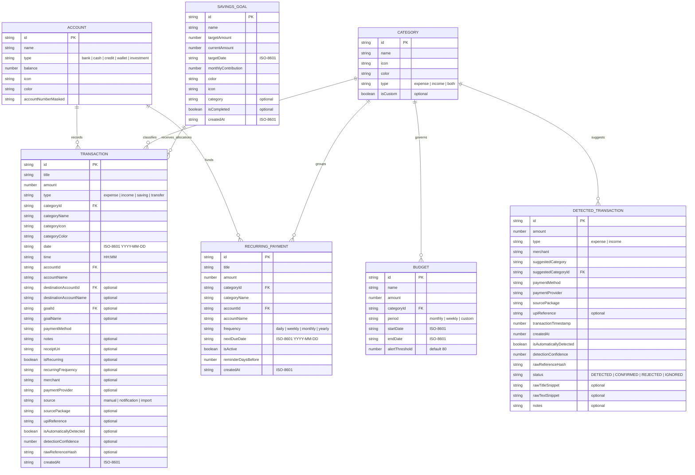

# Phase 6: Database & Storage Schema Documentation — PocketWise

PocketWise utilizes an **Offline-First Schema-Driven Document Storage Architecture** backed by:
1. **Client Persistence Engine**: `@react-native-async-storage/async-storage` storing normalized JSON entity collections.
2. **Native Android Persistence Engine**: Android `SharedPreferences` storing binary-sandboxed JSON strings for background UPI notifications.

---

## 1. Entity-Relationship Diagram (ERD)

The following Mermaid ER diagram illustrates the complete relational topology, primary keys (PK), foreign keys (FK), and referential links between entities:



---

## 2. Table-by-Table Schema Specification

### 2.1 `Transaction` Collection
- **Storage Key**: `@pocketwise_transactions_v2`
- **Definition**: [src/types/index.ts](file:///D:/Pocketwise/src/types/index.ts#L3-L34)

| Field Name | Data Type | Nullable | Primary / Foreign Key | Description & Constraints |
| :--- | :--- | :---: | :---: | :--- |
| `id` | `string` | NO | **PK** | Unique identifier format: `tx-<timestamp>-<rand>` |
| `title` | `string` | NO | - | Description or merchant name (e.g. `"Starbucks Coffee"`) |
| `amount` | `number` | NO | - | Positive decimal numeric value (`amount > 0`) |
| `type` | `string` | NO | - | Enum: `'expense'`, `'income'`, `'saving'`, `'transfer'` |
| `categoryId` | `string` | NO | **FK** | References `Category.id` (e.g. `'cat-food'`) |
| `categoryName` | `string` | NO | - | Denormalized category display label |
| `categoryIcon` | `string` | NO | - | Feather icon identifier (e.g. `'utensils'`) |
| `categoryColor` | `string` | NO | - | Hex color code (e.g. `'#F97316'`) |
| `date` | `string` | NO | - | ISO-8601 formatted date string (`YYYY-MM-DD` or full ISO) |
| `time` | `string` | YES | - | 24-hour time string (`HH:MM`) |
| `accountId` | `string` | NO | **FK** | References primary `Account.id` |
| `accountName` | `string` | NO | - | Denormalized primary account label |
| `destinationAccountId` | `string` | YES | **FK** | References recipient `Account.id` (for `type === 'transfer'`) |
| `destinationAccountName` | `string` | YES | - | Denormalized recipient account label |
| `goalId` | `string` | YES | **FK** | References target `SavingsGoal.id` (for `type === 'saving'`) |
| `goalName` | `string` | YES | - | Denormalized goal name |
| `paymentMethod` | `string` | NO | - | Label: `'UPI'`, `'Bank Transfer'`, `'Cash'`, `'Credit Card'`, etc. |
| `notes` | `string` | YES | - | User memo or auto-detection audit text |
| `receiptUri` | `string` | YES | - | Local file URI for attached receipt image |
| `isRecurring` | `boolean` | YES | - | Flag indicating recurring origin |
| `recurringFrequency` | `string` | YES | - | Enum: `'daily'`, `'weekly'`, `'monthly'`, `'yearly'` |
| `merchant` | `string` | YES | - | Normalized merchant payee name |
| `paymentProvider` | `string` | YES | - | Name of payment app (e.g. `'Google Pay'`, `'PhonePe'`) |
| `source` | `string` | YES | - | Enum: `'manual'`, `'notification'`, `'import'` |
| `sourcePackage` | `string` | YES | - | Android package ID (e.g. `'com.phonepe.app'`) |
| `upiReference` | `string` | YES | - | 12-digit NPCI RRN or bank UTR number |
| `isAutomaticallyDetected`| `boolean`| YES | - | Flag indicating background capture |
| `detectionConfidence` | `number` | YES | - | Float range `0.0` to `1.0` |
| `rawReferenceHash` | `string` | YES | - | Deduplication hash string |
| `createdAt` | `string` | NO | - | ISO-8601 creation timestamp |

---

### 2.2 `Account` Collection
- **Storage Key**: `@pocketwise_accounts_v2`
- **Definition**: [src/types/index.ts](file:///D:/Pocketwise/src/types/index.ts#L68-L76)

| Field Name | Data Type | Nullable | Primary / Foreign Key | Description & Constraints |
| :--- | :--- | :---: | :---: | :--- |
| `id` | `string` | NO | **PK** | Unique identifier format: `acc-<timestamp>` |
| `name` | `string` | NO | - | Display label (e.g. `"HDFC Salary Account"`, `"Cash"`) |
| `type` | `string` | NO | - | Enum: `'bank'`, `'cash'`, `'credit'`, `'wallet'`, `'investment'` |
| `balance` | `number` | NO | - | Current live balance (can be negative for credit cards) |
| `icon` | `string` | NO | - | Feather icon name |
| `color` | `string` | NO | - | Hex theme color |
| `accountNumberMasked` | `string` | YES | - | Masked identifier (e.g. `"•••• 4821"`) |

---

### 2.3 `Budget` Collection
- **Storage Key**: `@pocketwise_budgets_v2`
- **Definition**: [src/types/index.ts](file:///D:/Pocketwise/src/types/index.ts#L78-L87)

| Field Name | Data Type | Nullable | Primary / Foreign Key | Description & Constraints |
| :--- | :--- | :---: | :---: | :--- |
| `id` | `string` | NO | **PK** | Unique identifier format: `bgt-<timestamp>` |
| `name` | `string` | NO | - | Display title (e.g. `"Food & Groceries"`) |
| `amount` | `number` | NO | - | Spending ceiling for the defined period |
| `categoryId` | `string` | NO | **FK** | References `Category.id` |
| `period` | `string` | NO | - | Enum: `'monthly'`, `'weekly'`, `'custom'` |
| `startDate` | `string` | NO | - | ISO-8601 start boundary |
| `endDate` | `string` | NO | - | ISO-8601 end boundary |
| `alertThreshold` | `number` | YES | - | Warning trigger percentage (defaults to `80`) |

---

### 2.4 `SavingsGoal` Collection
- **Storage Key**: `@pocketwise_savings_goals_v2`
- **Definition**: [src/types/index.ts](file:///D:/Pocketwise/src/types/index.ts#L89-L101)

| Field Name | Data Type | Nullable | Primary / Foreign Key | Description & Constraints |
| :--- | :--- | :---: | :---: | :--- |
| `id` | `string` | NO | **PK** | Unique identifier format: `goal-<timestamp>` |
| `name` | `string` | NO | - | Goal title (e.g. `"Emergency Fund"`) |
| `targetAmount` | `number` | NO | - | Total target savings amount |
| `currentAmount` | `number` | NO | - | Current accumulated funds |
| `targetDate` | `string` | NO | - | ISO-8601 deadline date (`YYYY-MM-DD`) |
| `monthlyContribution` | `number` | NO | - | Planned monthly allocation |
| `color` | `string` | NO | - | Hex accent color |
| `icon` | `string` | NO | - | Feather icon name |
| `category` | `string` | YES | - | Qualitative tag (e.g. `'Safety'`, `'Travel'`) |
| `isCompleted` | `boolean` | YES | - | `true` when `currentAmount >= targetAmount` |
| `createdAt` | `string` | NO | - | ISO-8601 creation timestamp |

---

### 2.5 `RecurringPayment` Collection
- **Storage Key**: `@pocketwise_recurring_v2`
- **Definition**: [src/types/index.ts](file:///D:/Pocketwise/src/types/index.ts#L103-L116)

| Field Name | Data Type | Nullable | Primary / Foreign Key | Description & Constraints |
| :--- | :--- | :---: | :---: | :--- |
| `id` | `string` | NO | **PK** | Unique identifier format: `rec-<timestamp>` |
| `title` | `string` | NO | - | Bill title (e.g. `"Netflix Subscription"`) |
| `amount` | `number` | NO | - | Payment charge amount |
| `categoryId` | `string` | NO | **FK** | References `Category.id` |
| `categoryName` | `string` | NO | - | Denormalized category label |
| `accountId` | `string` | NO | **FK** | References default funding `Account.id` |
| `accountName` | `string` | NO | - | Denormalized account label |
| `frequency` | `string` | NO | - | Enum: `'daily'`, `'weekly'`, `'monthly'`, `'yearly'` |
| `nextDueDate` | `string` | NO | - | Next renewal date (`YYYY-MM-DD`) |
| `isActive` | `boolean` | NO | - | Toggles reminder evaluation |
| `reminderDaysBefore`| `number` | NO | - | Days prior to due date to alert user (1-7) |
| `createdAt` | `string` | NO | - | ISO-8601 creation timestamp |

---

### 2.6 `Category` Collection
- **Storage Key**: `@pocketwise_categories_v2`
- **Definition**: [src/types/index.ts](file:///D:/Pocketwise/src/types/index.ts#L118-L125)

| Field Name | Data Type | Nullable | Description & Default Values |
| :--- | :--- | :---: | :--- |
| `id` | `string` | NO | **PK**: e.g. `'cat-food'`, `'cat-transport'`, `'cat-salary'` |
| `name` | `string` | NO | Display label (e.g. `"Food & Dining"`) |
| `icon` | `string` | NO | Feather icon name |
| `color` | `string` | NO | Hex color code |
| `type` | `string` | NO | Enum: `'expense'`, `'income'`, `'both'` |
| `isCustom` | `boolean` | YES | `true` if created dynamically by user |

---

### 2.7 `DetectedTransaction` Collection (Native Android & JS Mirror)
- **Storage Key (JS)**: `@pocketwise_detected_transactions_v2`
- **Native Key (Android)**: `pocketwise_upi_storage -> detected_transactions` (capped at 200 items)
- **Definition**: [src/types/index.ts](file:///D:/Pocketwise/src/types/index.ts#L38-L58)

| Field Name | Data Type | Nullable | Description |
| :--- | :--- | :---: | :--- |
| `id` | `string` | NO | **PK**: `upi-<timestamp>-<hash>` |
| `amount` | `number` | NO | Parsed decimal payment amount |
| `type` | `string` | NO | Enum: `'expense'`, `'income'` (for refunds) |
| `merchant` | `string` | NO | Cleaned payee name |
| `suggestedCategory`| `string` | NO | Auto-categorized category name |
| `suggestedCategoryId`| `string`| NO | **FK** to `Category.id` |
| `paymentMethod` | `string` | NO | Fixed as `'UPI'` |
| `paymentProvider`| `string` | NO | Detected app (e.g. `'Google Pay'`) |
| `sourcePackage` | `string` | NO | Android package name |
| `upiReference` | `string` | YES | 12-digit UTR reference |
| `transactionTimestamp`| `number`| NO | Epoch timestamp in milliseconds |
| `createdAt` | `number` | NO | Ingestion timestamp |
| `isAutomaticallyDetected`| `boolean`| NO | Fixed as `true` |
| `detectionConfidence`| `number`| NO | Calculated confidence (`0.50` - `0.99`) |
| `rawReferenceHash` | `string` | NO | Deduplication hash string |
| `status` | `string` | NO | Enum: `'DETECTED'`, `'CONFIRMED'`, `'REJECTED'`, `'IGNORED'` |
| `rawTitleSnippet` | `string` | YES | Truncated notification title (privacy-safe) |
| `rawTextSnippet` | `string` | YES | Truncated notification body (privacy-safe) |
| `notes` | `string` | YES | Automatic detection notes |

---

### 2.8 `UserSettings` Document
- **Storage Key**: `@pocketwise_settings_v2`
- **Definition**: [src/types/index.ts](file:///D:/Pocketwise/src/types/index.ts#L145-L158)

```json
{
  "userName": "Taha",
  "currency": "INR",
  "currencySymbol": "₹",
  "monthlyIncomeRange": "₹50,000 - ₹1,00,000",
  "mainSavingsGoal": "Emergency Fund",
  "preferredSavingTarget": 20,
  "themeMode": "light",
  "notifications": {
    "budgetWarnings": true,
    "recurringPayments": true,
    "savingsReminders": true,
    "monthlySummary": true,
    "goalMilestones": true,
    "automaticExpenseDetection": true,
    "autoConfirmHighConfidence": true,
    "detectRefunds": true,
    "detectBankNotifications": true
  },
  "securityEnabled": false,
  "hasCompletedOnboarding": true,
  "hasCompletedWalkthrough": true
}
```

---

## 3. Referential Integrity & Cascade Behavior

Because `@react-native-async-storage/async-storage` is a NoSQL key-value document store rather than an ACID relational engine (such as SQLite or PostgreSQL), referential integrity is enforced **programmatically in `useAppStore.ts`**:

1. **Transaction Deletion Cascade**:
   - Deleting a transaction does NOT delete the linked `Account` or `SavingsGoal`. Instead, it automatically executes a **Balance Reversal**:
     $$\text{Account.balance} \leftarrow \text{Account.balance} \pm \text{Transaction.amount}$$
     $$\text{SavingsGoal.currentAmount} \leftarrow \text{SavingsGoal.currentAmount} - \text{Transaction.amount}$$
2. **Account Deletion Safeguard**:
   - When an account is deleted, existing transactions retaining its `accountId` remain intact in history to preserve reporting accuracy.
   - If a transaction is added when zero accounts exist, `useAppStore.addTransaction` automatically bootstraps a default `'Cash'` account with balance 0.
3. **Storage Migration History**:
   - The `@pocketwise_*_v2` keys signify the current V2 schema generation.
   - V2 introduced dedicated fields for UPI detection (`isAutomaticallyDetected`, `detectionConfidence`, `rawReferenceHash`, `upiReference`) and normalized category mappings.

