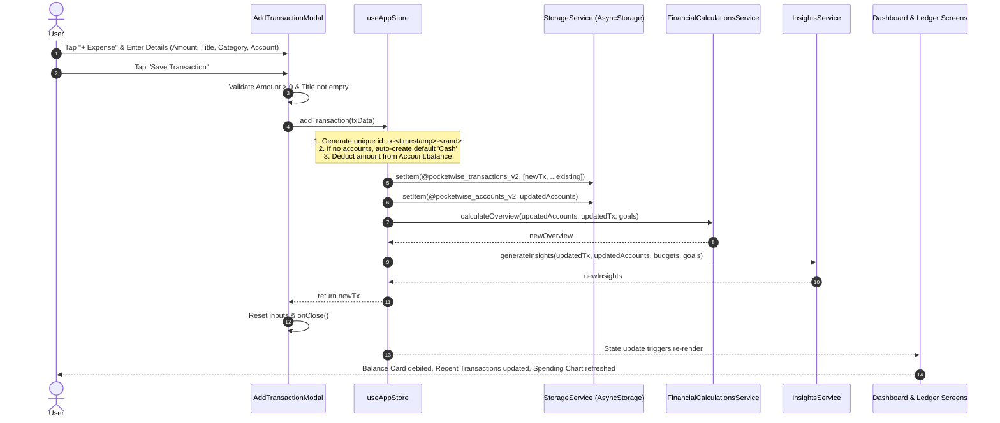
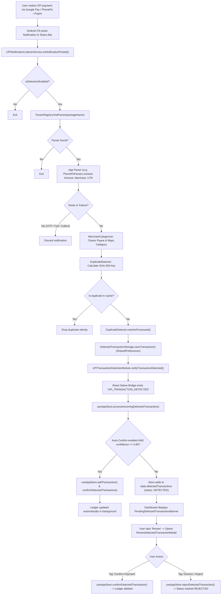
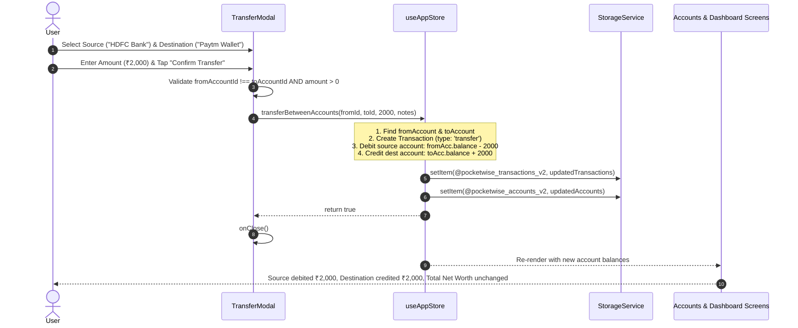
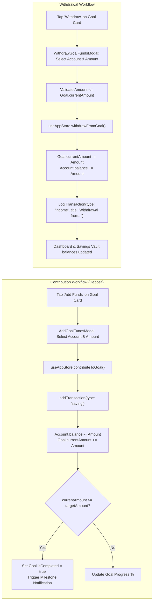
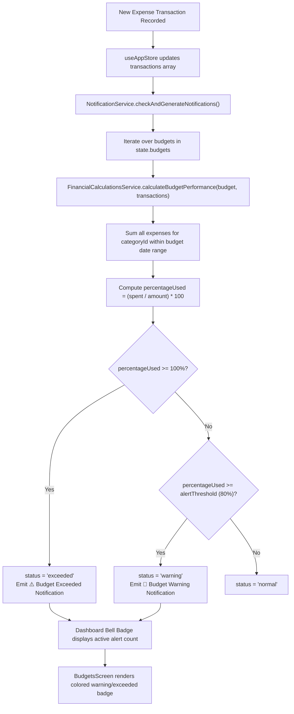
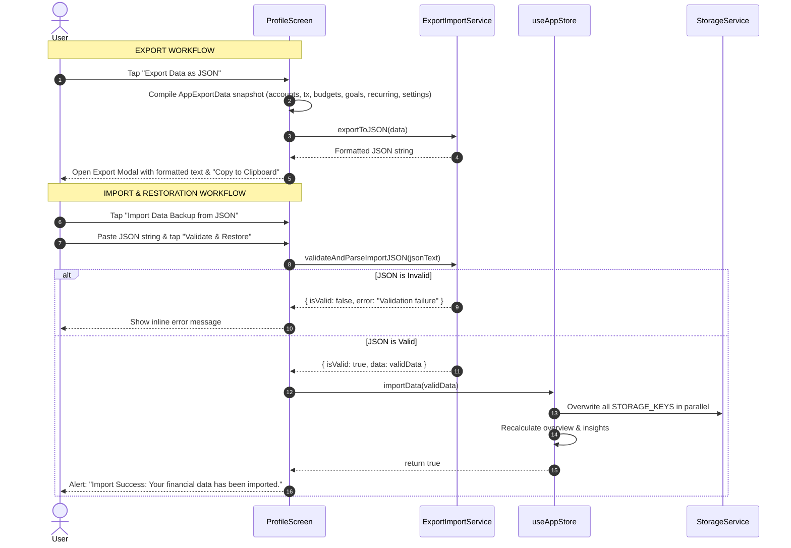

# Phase 7: End-to-End Business Logic & Workflows — PocketWise

This document diagrams the complete lifecycle of core business operations in PocketWise, detailing every hop from user touch event through UI validation, Zustand state mutation, native Android service execution, database persistence, and visual recalculation.

---

## Workflow 1: End-to-End Expense Logging & Account Balance Debit

### Detailed Trace:
1. **Starting Point**: User taps `+ Expense` in [DashboardScreen.tsx](file:///D:/Pocketwise/src/screens/dashboard/DashboardScreen.tsx) or [TransactionsScreen.tsx](file:///D:/Pocketwise/src/screens/transactions/TransactionsScreen.tsx).
2. **User Action**: Fills amount (e.g. `₹350`), title (`"Lunch at Bistro"`), selects category (`Food & Dining`), selects account (`HDFC Salary`), and taps "Save Transaction".
3. **Frontend Processing**: [AddTransactionModal.tsx](file:///D:/Pocketwise/src/components/modals/AddTransactionModal.tsx#L80) validates that `numAmount > 0` and `title.trim()` is not blank.
4. **Store Action**: `useAppStore.addTransaction()` in [useAppStore.ts](file:///D:/Pocketwise/src/store/useAppStore.ts#L279).
5. **Business Logic & Balance Update**:
   - Matches `acc.id === newTx.accountId` and calculates:
     $$\text{Account.balance} \leftarrow \text{Account.balance} - 350$$
6. **Database Persistence**: Writes in parallel via `Promise.all` to `@pocketwise_transactions_v2` and `@pocketwise_accounts_v2`.
7. **Recalibration**: Invokes `calculateOverview()` and `generateInsights()`.
8. **Result Shown to User**: Modal closes smoothly, Available Balance is decremented by ₹350, the transaction appears at the top of the transaction list, and the monthly budget utilization bar advances.

---

## Workflow 2: Background Automatic UPI Payment Ingestion & Review

### Detailed Trace:
1. **Starting Point**: User completes a ₹120 tea/snacks payment via PhonePe.
2. **Background Trigger**: Android OS delivers a notification from `com.phonepe.app`.
3. **Native Service Execution**: [UPINotificationListenerService.kt](file:///D:/Pocketwise/src/native/android/service/UPINotificationListenerService.kt) captures the notification extras.
4. **Parsing & Clean-up**:
   - `PhonePeParser.kt` extracts `amount = 120.0` and `merchant = "Chai Point"`.
   - `MerchantCategorizer.kt` recognizes keyword `"chai"` and assigns `suggestedCategory = "Food & Dining"`, `confidence = 0.88`.
5. **Deduplication Check**:
   - `DuplicateDetector.kt` computes SHA-256 hash. If received again within 5 minutes, it is dropped.
6. **Native Storage**: Saved to Android `SharedPreferences` (`pocketwise_upi_storage`).
7. **Bridge Emission**: Dispatched via `DeviceEventManagerModule` to React Native.
8. **UI Presentation**:
   - If auto-confirm is enabled and confidence $\ge 0.85$, the transaction is automatically added to the ledger.
   - Otherwise, `PendingDetectedTransactionsBanner` appears on the dashboard with a "Review" button.
9. **User Confirmation**: User inspects the details in [ReviewDetectedTransactionModal.tsx](file:///D:/Pocketwise/src/components/modals/ReviewDetectedTransactionModal.tsx) and taps "Confirm Payment".

---

## Workflow 3: Internal Account-to-Account Fund Transfer

### Detailed Trace:
1. **Starting Point**: User taps "Transfer" in [AccountsScreen.tsx](file:///D:/Pocketwise/src/screens/accounts/AccountsScreen.tsx) or [BalanceCard.tsx](file:///D:/Pocketwise/src/components/financial/BalanceCard.tsx).
2. **User Action**: Selects source account (`fromAccountId`), destination account (`toAccountId`), enters transfer amount (`₹2,000`), and optional notes.
3. **Frontend Validation**: [TransferModal.tsx](file:///D:/Pocketwise/src/components/modals/TransferModal.tsx#L60) verifies that the source and destination accounts are distinct and that amount is positive.
4. **Store Execution**: `useAppStore.transferBetweenAccounts()` calls `addTransaction()` with `type: 'transfer'`.
5. **Balance Update**:
   $$\text{fromAccount.balance} \leftarrow \text{fromAccount.balance} - 2000$$
   $$\text{toAccount.balance} \leftarrow \text{toAccount.balance} + 2000$$
6. **Net Liquid Impact**: Zero net balance change; total net worth remains balanced while individual liquidity pools update accurately.

---

## Workflow 4: Savings Goal Contribution & Fund Withdrawal

---

## Workflow 5: Category Budget Warning & Threshold Evaluation

---

## Workflow 6: Data Backup Export & JSON Restoration

