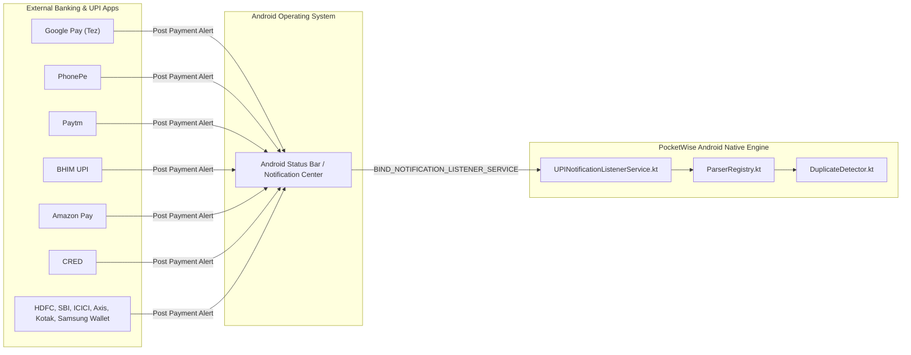

# Phase 8: Third-Party Integrations & Ecosystem Audit — PocketWise

This document audits all third-party services, native integrations, operating system hooks, and payment application interfaces in PocketWise.

---

## 1. Third-Party Integrations Inventory

| Integration Category | Provider / Service | Implementation Mechanism | Status |
| :--- | :--- | :--- | :---: |
| **Payment Gateways** | None (Stripe, Razorpay, etc.) | N/A — PocketWise is a personal finance tracker, not an e-commerce merchant. | **Not Present / By Design** |
| **Authentication Providers** | None (Firebase, Auth0, Supabase) | Local profile setup and device-level security. | **Not Present / By Design** |
| **Remote Push Notifications** | None (Firebase FCM, Apple APNs) | App relies exclusively on on-device notification listener and local reminders. | **Not Present / By Design** |
| **Cloud Storage & Sync** | None (AWS S3, Google Drive, iCloud) | Local persistence in `AsyncStorage` and manual JSON export/import. | **Not Present / By Design** |
| **Location & Maps** | None (Google Maps, Mapbox) | N/A — No geofencing or location tracking. | **Not Present / By Design** |
| **Analytics & Telemetry** | None (Mixpanel, Segment, Sentry) | Zero telemetry tracking. Complete user privacy. | **Not Present / By Design** |
| **External UPI Payment Apps** | Google Pay, PhonePe, Paytm, BHIM, Amazon Pay, CRED, Bank Apps | Android `NotificationListenerService` parsing status bar alerts. | **Active & Fully Integrated** |
| **Cloud Build Infrastructure** | Expo Application Services (EAS Build) | EAS CLI & cloud compilation servers (`eas.json`). | **Active & Configured** |

---

## 2. Deep Dive: Android UPI & Banking App Ecosystem Integration

### 2.1 Integration Purpose & Architecture
PocketWise does not use banking APIs (such as Open Banking / Account Aggregator) or credential screen-scraping. Instead, it integrates with the Android OS notification subsystem via a native **Notification Listener Service** (`android.service.notification.NotificationListenerService`).

When an authorized financial application posts a payment confirmation notification to the device status bar, PocketWise captures the notification components, parses the transaction details, and imports them.

---

### 2.2 Supported Applications & Identification Matrix

| Application | Package Identifier (`packageName`) | Parser Class | Data Extracted |
| :--- | :--- | :--- | :--- |
| **Google Pay** | `com.google.android.apps.nbu.paisa.user` | `GooglePayParser.kt` | Amount, Payee, UPI UTR, Source Account |
| **PhonePe** | `com.phonepe.app` | `PhonePeParser.kt` | Amount, Merchant, UTR, Refund flag |
| **Paytm** | `net.one97.paytm` | `PaytmParser.kt` | Amount, Payee, UPI Ref, Wallet vs Bank |
| **BHIM UPI** | `in.org.npci.upiapp` | `BHIMParser.kt` | NPCI standardized debit confirmation, UTR |
| **Amazon Pay** | `in.amazon.mShop.android.shopping`, `com.amazon.mShop.android.shopping` | `AmazonPayParser.kt` | Order payments, UPI transfers, Refund alerts |
| **CRED** | `com.dreamplug.androidapp` | `CredParser.kt` | CRED UPI debit alerts, merchant tags |
| **HDFC Mobile** | `com.snapwork.hdfc` | `GenericBankUPIParser.kt` | UPI debit notifications, masked account |
| **SBI YONO** | `com.sbi.lotusintouch`, `com.sbi.SBIFreedomPlus` | `GenericBankUPIParser.kt` | SBI debit alerts, UPI reference |
| **ICICI iMobile**| `com.csam.icici.bank.imobile` | `GenericBankUPIParser.kt` | ICICI debit alerts, VPA payee |
| **Axis Mobile** | `com.axis.mobile` | `GenericBankUPIParser.kt` | Axis UPI debits, payee details |
| **Kotak Mobile**| `com.kotak.mb` | `GenericBankUPIParser.kt` | Kotak UPI debit alerts |
| **Samsung Wallet**| `com.samsung.android.spay` | `GenericBankUPIParser.kt` | Samsung Pay UPI debit confirmations |

---

### 2.3 Security, Privacy & Compliance Model
- **No Private Financial Credentials Required**: PocketWise never requests bank account passwords, net banking credentials, MPINs, or debit card CVVs.
- **Strict Anti-Noise Filters**:
  - The notification parser explicitly discards any notification matching OTP keywords (`"OTP"`, `"verification code"`, `"one time password"`).
  - Balance inquiries and promotional offers are filtered out.
- **Zero Network Transmission**: Raw notification text never leaves the device.
- **Google Play Store Policy Compliance**: By relying on `NotificationListenerService` rather than high-risk `READ_SMS` / `RECEIVE_SMS` permissions, PocketWise complies with Google Play policies governing personal financial applications.

---

## 3. Expo Application Services (EAS) Cloud Integration

PocketWise integrates with Expo Application Services (EAS) for cloud building and continuous integration:

- **EAS Project ID**: `db6674ea-3c16-41da-8ece-8426af9a7ac9` (declared in `app.json`).
- **Configuration File**: [eas.json](file:///D:/Pocketwise/eas.json).
- **Profiles Defined**:
  1. `development`: Builds an Android APK with `developmentClient: true` enabling live debugging of native Kotlin modules.
  2. `preview`: Builds an internal test APK for non-developer stakeholders.
  3. `production`: Builds an Android App Bundle (`.aab`) optimized for Play Store distribution.

---

## 4. Failure Handling & Resilience

| Potential Failure Point | Root Cause | System Resilience / Fallback |
| :--- | :--- | :--- |
| **Notification Format Shift** | Payment app updates notification wording after an app update. | The parser falls back to generic regex patterns (`GenericBankUPIParser.kt`). If extraction fails, the notification is safely dropped without crashing. |
| **OS Memory Killer (OEMs)** | Aggressive battery management (MIUI, OneUI) kills background listener. | `AutomaticDetectionSettingsScreen.tsx` provides an OEM Battery Optimization Guide directing users to disable aggressive battery savers. |
| **Duplicate Notifications** | Payment app posts both a heads-up alert and an inbox notification. | `DuplicateDetector.kt` computes SHA-256 hashes and discards duplicates within a 5-minute tolerance window. |
| **Unsupported Platform (iOS/Web)** | Running on iOS or Web where Android NotificationListener is unavailable. | `UPIDetectionService.isAvailable()` checks `Platform.OS === 'android'` and returns fallback values gracefully. |

