# PocketWise — Complete Master Project Context & AI Reference Guide

> **AI AGENT INSTRUCTION**: This document is the single, authoritative, consolidated reference for the entire **PocketWise** codebase. It contains the complete architectural blueprint, technology inventory, data schemas, API interfaces, screen inventories, business logic, native Android background detection engine, file dependency maps, and known technical debt. Read this document to understand, debug, maintain, test, or extend PocketWise without needing any external context.

---

## 1. Executive Summary & Core Identity

- **Application Name**: PocketWise
- **Android Package Identifier**: `com.taha_911.pocketwise`
- **Application Slug & Version**: `pocketwise`, version `1.0.0`
- **Architecture Paradigm**: **100% Offline-First, Single-User On-Device Client** with a Background Native Android Ingestion Engine.
- **Primary Value Proposition**: A personal finance manager, wealth vault, and expense tracker that automatically captures and categorizes UPI payment notifications on Android devices without cloud intermediation, banking logins, SMS scraper permissions, or third-party telemetry.
- **Target Audience**: Everyday mobile users, salaried professionals, freelancers, and students (particularly digital payment & UPI power users) managing multi-account liquid balances, category budgets, savings goals, and recurring commitments.

---

## 2. Technology Stack & Framework Truths

> [!IMPORTANT]
> **CRITICAL ARCHITECTURAL REALITY**:
> - **Navigation**: PocketWise strictly uses **React Navigation v7** (`@react-navigation/native`, `@react-navigation/native-stack`, `@react-navigation/bottom-tabs`). Although standard Expo templates or outdated repo notes (e.g. `AGENTS.md`) may mention Expo Router, **Expo Router is NOT used**. There is no `src/app/` directory. All routes live in `src/navigation/`.
> - **Backend / Cloud**: There is **NO remote cloud REST/GraphQL backend, NO Supabase/Firebase Auth, and NO remote database**. All data resides locally in `AsyncStorage` and Android `SharedPreferences`.
> - **Native Android Background Daemon**: A custom native Kotlin service (`UPINotificationListenerService.kt`) runs continuously in the Android OS layer to capture status bar payment notifications.

### Dependency Inventory (Extracted from `package.json` & `app.json`)
| Layer | Package / Tool | Version | Responsibility |
| :--- | :--- | :--- | :--- |
| **Mobile Runtime** | `react-native` | `0.86.3` | Cross-platform core runtime |
| **UI Library** | `react` | `19.2.3` | Functional component rendering & hooks |
| **App Framework** | `expo` | `~57.0.27` | Native build harness, font loader, splash controller |
| **Navigation Core** | `@react-navigation/native` | `^7.5.0` | Navigation container & themes |
| **Stack Navigation** | `@react-navigation/native-stack`| `^7.20.0` | Native screen transitions & modal sheets |
| **Tab Navigation** | `@react-navigation/bottom-tabs` | `^7.20.0` | 5-tab persistent bottom navigation bar |
| **Global State** | `zustand` | `^5.0.15` | Single centralized state store (`useAppStore.ts`) |
| **Client Storage** | `@react-native-async-storage/async-storage` | `2.2.0` | On-device JSON document persistence |
| **Native Storage** | Android `SharedPreferences` | `Context.MODE_PRIVATE` | Background listener persistent transaction & dedup cache |
| **Native Daemon** | Kotlin / AndroidX Core | SDK 34/35 | `NotificationListenerService` & bridge module |
| **Config Plugins** | `@expo/config-plugins` | Custom (`plugins/withUpiDetector.js`) | Continuous Native Generation (injects Kotlin & manifests) |
| **Gestures & Worklets**| `react-native-gesture-handler`<br/>`react-native-reanimated`<br/>`react-native-worklets` | `~2.32.0`<br/>`4.5.1`<br/>`0.10.1` | Native touch dispatcher & UI-thread animations |
| **Icons & Vectors** | `@expo/vector-icons` (Feather)<br/>`react-native-svg` | `^15.0.2`<br/>`15.15.4` | Icon set & chart rendering |
| **Unit Testing** | `jest` / `ts-jest` | `~29.7.0` / `^29.4.14` | Test runner (26 unit tests passing) |
| **Cloud Builds** | Expo Application Services (EAS Build) | EAS Project `db6674ea-3c16-41da-8ece-8426af9a7ac9` | Android App Bundle (`.aab`) generation |

---

## 3. Complete Codebase Directory & File Structure

```
D:\Pocketwise\
├── assets/                               # Static app icons, splash screens, adaptive icons
├── plugins/
│   └── withUpiDetector.js                # Expo config plugin copying native Kotlin code & modifying AndroidManifest
├── src/
│   ├── components/
│   │   ├── common/                       # Reusable Atomic UI Primitives
│   │   │   ├── AppButton.tsx             # Styled button (variants: primary, secondary, outline, danger, ghost)
│   │   │   ├── AppCard.tsx               # (Unused dead code - see Audit) Base elevated container
│   │   │   ├── AppHeader.tsx             # (Unused dead code - see Audit) Navigation header
│   │   │   ├── AppInput.tsx              # Input with icons, currency prefix, clear action, error label
│   │   │   ├── AppText.tsx               # Typography primitive (h1-h3, body1-2, caption, amount)
│   │   │   ├── Badge.tsx                 # Status pill (normal, warning, error, info)
│   │   │   ├── CategoryIcon.tsx          # 40px rounded circle with category icon & hex color
│   │   │   ├── ConfirmDialog.tsx         # Modal dialog for confirming destructive operations
│   │   │   ├── EmptyState.tsx            # Illustrated empty view with call-to-action button
│   │   │   └── ProgressBar.tsx           # Percentage progress bar
│   │   ├── financial/                    # Domain-Specific Financial Visual Widgets
│   │   │   ├── BalanceCard.tsx           # Net liquid balance, growth rate badge, savings rate %
│   │   │   ├── CategoryBreakdown.tsx     # Ranked category spend breakdown with percentage bars
│   │   │   ├── FinancialInsightCard.tsx  # Recommendation cards (savings tips, warnings, achievements)
│   │   │   ├── MonthlyOverviewCard.tsx   # Income vs. Expense ratio comparison summary
│   │   │   ├── PendingDetectedTransactionsBanner.tsx # Alert banner for unreviewed detected UPI payments
│   │   │   ├── QuickActions.tsx          # 4 buttons (+ Expense, + Income, Saving, Transfer)
│   │   │   ├── SavingsGoalCard.tsx       # Goal progress card with required monthly deposit metric
│   │   │   ├── SpendingChart.tsx         # 7-day spending bar chart
│   │   │   ├── TransactionItem.tsx       # Standard ledger row component
│   │   │   └── UpcomingPaymentCard.tsx   # Bill reminder card with "Pay Now" 1-tap ledger button
│   │   └── modals/                       # Form Dialogs & Full-Screen Overlays
│   │       ├── AddBudgetModal.tsx        # Set category limit amount & 80% threshold
│   │       ├── AddGoalFundsModal.tsx     # Deposit funds from account into a savings goal
│   │       ├── AddGoalModal.tsx          # Create new savings target
│   │       ├── AddRecurringModal.tsx     # Schedule subscription / bill reminder
│   │       ├── AddTransactionModal.tsx   # Create Expense, Income, or Saving transaction
│   │       ├── ReviewDetectedTransactionModal.tsx # Review, edit, confirm, or reject detected UPI payments
│   │       ├── TransferModal.tsx         # Transfer funds between two user accounts
│   │       ├── WalkthroughModal.tsx      # 9-step interactive guided app walkthrough
│   │       └── WithdrawGoalFundsModal.tsx# Withdraw funds from savings goal back to account
│   ├── constants/
│   │   ├── categories.ts                 # 18 default categories (12 expense, 6 income, 2 transfer/savings)
│   │   ├── initialData.ts                # Initial empty state models + optional DEMO data fixtures
│   │   └── paymentMethods.ts             # Supported payment methods & 8 world currencies
│   ├── hooks/
│   │   └── useTheme.ts                   # Hook providing colors, spacing, radius, shadows, isDark
│   ├── native/android/                   # Android Background Notification Engine (Kotlin)
│   │   ├── categorizer/MerchantCategorizer.kt # Merchant name normalization & keyword categorization
│   │   ├── dedup/DuplicateDetector.kt    # SHA-256 LRU ring buffer (5-min tolerance window)
│   │   ├── model/DetectedTransaction.kt  # Kotlin data class for detected transactions
│   │   ├── module/
│   │   │   ├── UPITransactionDetectionModule.kt # React Native Bridge Java/Kotlin module (12 methods)
│   │   │   └── UPITransactionDetectionPackage.kt# ReactPackage registration
│   │   ├── parser/                       # Notification Parsers (Regex & Pattern matchers)
│   │   │   ├── AmazonPayParser.kt, BHIMParser.kt, CredParser.kt, GenericBankUPIParser.kt,
│   │   │   ├── GooglePayParser.kt, NotificationParser.kt, ParserRegistry.kt, PaytmParser.kt, PhonePeParser.kt
│   │   ├── service/UPINotificationListenerService.kt # Android NotificationListenerService implementation
│   │   └── storage/DetectedTransactionStorage.kt    # SharedPreferences persistent cache (max 200 items)
│   ├── navigation/
│   │   ├── BottomTabNavigator.tsx        # 5 tabs: Home, Transactions, Budgets, Savings, Profile
│   │   └── RootNavigator.tsx             # Native stack: Onboarding gate, MainTabs, Modal routes
│   ├── screens/
│   │   ├── accounts/AccountsScreen.tsx   # Account balance manager & internal transfer hub
│   │   ├── budgets/BudgetsScreen.tsx     # Category budget cards with 80%/100% status badges
│   │   ├── calendar/CalendarScreen.tsx   # Monthly calendar grid with daily activity markers
│   │   ├── dashboard/DashboardScreen.tsx # Executive cockpit with quick actions & balance cards
│   │   ├── onboarding/OnboardingScreen.tsx # Feature carousel, profile personalization & account setup
│   │   ├── profile/ProfileScreen.tsx     # Preferences, currency, dark mode, backup JSON/CSV, reset
│   │   ├── recurring/RecurringScreen.tsx # Subscriptions & recurring bill tracker
│   │   ├── reports/ReportsScreen.tsx     # Cash flow analytics across 5 time periods (7d, 30d, 3m, 6m, 1y)
│   │   ├── savings/SavingsScreen.tsx     # Savings goal cards & 20% smart savings recommendations
│   │   ├── settings/AutomaticDetectionSettingsScreen.tsx # UPI detection status, toggles, test simulator
│   │   └── transactions/
│   │       ├── TransactionDetailScreen.tsx # Detailed view, duplicate action, delete with balance rollback
│   │       └── TransactionsScreen.tsx    # Filterable ledger (search, type tabs, category pills)
│   ├── services/
│   │   ├── exportImportService.ts        # JSON export/import schema validator & CSV serializer
│   │   ├── financialCalculations.ts      # Pure mathematical engine (overviews, budgets, goals)
│   │   ├── insightsService.ts            # Rule-based AI financial insights generator
│   │   ├── notificationService.ts        # In-app budget warnings & recurring due date evaluator
│   │   ├── upiDetectionService.ts        # TypeScript wrapper for NativeModules bridge calls & events
│   │   └── upiParser.ts                  # Pure JS mirror of UPI parsers for testing & simulation
│   ├── storage/
│   │   ├── keys.ts                       # Versioned storage keys (@pocketwise_*_v2)
│   │   └── storageService.ts             # Typed AsyncStorage wrapper with defensive try/catch
│   ├── store/
│   │   └── useAppStore.ts                # Single Zustand store (state, 30 actions, hydration)
│   ├── theme/                            # Design tokens (colors, spacing, radius, shadows, typography)
│   ├── types/index.ts                    # TypeScript definitions for all domain entities
│   └── __tests__/                        # Automated Jest unit tests (26 passed)
├── App.tsx                               # Application root (GestureHandler, SafeArea, hydration guard)
├── app.json                              # Expo app configuration & plugins
├── eas.json                              # EAS Cloud build profiles
├── index.ts                              # Entry point invoking registerRootComponent(App)
├── jest.config.js                        # Jest configuration with React Native mocks
└── package.json                          # Dependencies & build scripts
```

---

## 4. Master System Architecture Diagram

```mermaid
graph TB
    subgraph Native_Android_Engine ["Android Native OS Subsystem (Kotlin)"]
        Alert["Incoming Status Bar Notification (GPay, PhonePe, Paytm, Banks)"] --> Service["UPINotificationListenerService.kt"]
        Service --> NoiseFilter{"Noise / Failure / OTP Check"}
        NoiseFilter -- Discard --> Drop["Drop Silently"]
        NoiseFilter -- Valid --> Registry["ParserRegistry.findParser()"]
        Registry --> AppParser["App Parser (e.g. PhonePeParser)"]
        AppParser --> Categorizer["MerchantCategorizer.kt"]
        Categorizer --> Dedup["DuplicateDetector.kt (SHA-256 LRU Cache)"]
        Dedup --> NativeStorage["DetectedTransactionStorage (SharedPreferences)"]
        Dedup --> Bridge["UPITransactionDetectionModule.kt"]
    end

    subgraph RN_Bridge ["React Native Bridge Interface"]
        Bridge -- "RCTDeviceEventEmitter ('UPI_TRANSACTION_DETECTED')" --> JS_Bridge["UPIDetectionService.ts"]
    end

    subgraph Client_App ["PocketWise React Native Client (Zustand & UI)"]
        JS_Bridge --> Store["useAppStore.ts"]
        UI_Screens["Screens & Modals (Dashboard, Ledger, Budgets, Savings)"] <--> Store
        Store <--> CalcEngine["FinancialCalculationsService.ts"]
        Store <--> InsightsEngine["InsightsService.ts"]
        Store <--> NotifEngine["NotificationService.ts"]
        Store <--> Serializer["ExportImportService.ts"]
        Store <--> AsyncStorage[("@react-native-async-storage\n@pocketwise_*_v2")]
    end
```



---

## 5. Complete Database Schema & Storage Entity Map

### 5.1 Storage Keys Inventory
| Key Constant | Storage Mechanism | Type / Entity Stored | Max Size / Retention |
| :--- | :--- | :--- | :--- |
| `@pocketwise_transactions_v2` | `AsyncStorage` | `Transaction[]` | Unlimited (Local JSON file) |
| `@pocketwise_accounts_v2` | `AsyncStorage` | `Account[]` | All active user accounts |
| `@pocketwise_budgets_v2` | `AsyncStorage` | `Budget[]` | Active category spend ceilings |
| `@pocketwise_savings_goals_v2`| `AsyncStorage` | `SavingsGoal[]` | Active savings targets |
| `@pocketwise_recurring_v2` | `AsyncStorage` | `RecurringPayment[]`| Active recurring subscriptions |
| `@pocketwise_categories_v2` | `AsyncStorage` | `Category[]` | 18 default + custom categories |
| `@pocketwise_settings_v2` | `AsyncStorage` | `UserSettings` | User preferences & profile |
| `@pocketwise_detected_transactions_v2` | `AsyncStorage` | `DetectedTransaction[]`| Mirrored detected transactions |
| `pocketwise_upi_storage` | Android `SharedPreferences` | `detected_transactions` JSON array | Capped at 200 items (Ring buffer) |
| `pocketwise_dedup_cache` | Android `SharedPreferences` | `processed_keys` JSON array | Capped at 500 SHA-256 hashes |

---

### 5.2 Entity Data Dictionaries

#### `Transaction`
- `id: string` (PK, format: `tx-<timestamp>-<rand>`)
- `title: string` (e.g. `"Starbucks Coffee"`)
- `amount: number` (Numeric, > 0)
- `type: 'expense' | 'income' | 'saving' | 'transfer'`
- `categoryId: string` (FK -> `Category.id`)
- `categoryName: string`, `categoryIcon: string`, `categoryColor: string`
- `date: string` (ISO `YYYY-MM-DD`), `time?: string` (`HH:MM`)
- `accountId: string` (FK -> primary `Account.id`), `accountName: string`
- `destinationAccountId?: string` (FK -> recipient `Account.id` for transfers), `destinationAccountName?: string`
- `goalId?: string` (FK -> `SavingsGoal.id` for savings), `goalName?: string`
- `paymentMethod: string` (e.g. `'UPI'`, `'Bank Transfer'`, `'Cash'`, `'Credit Card'`)
- `notes?: string`, `receiptUri?: string`
- `isRecurring?: boolean`, `recurringFrequency?: 'daily' | 'weekly' | 'monthly' | 'yearly'`
- `merchant?: string`, `paymentProvider?: string`, `source?: 'manual' | 'notification' | 'import'`
- `sourcePackage?: string`, `upiReference?: string` (12-digit UTR), `isAutomaticallyDetected?: boolean`
- `detectionConfidence?: number` (0.0 to 1.0), `rawReferenceHash?: string`
- `createdAt: string` (ISO-8601)

#### `Account`
- `id: string` (PK, format: `acc-<timestamp>`)
- `name: string` (e.g. `"HDFC Salary"`, `"Cash"`)
- `type: 'bank' | 'cash' | 'credit' | 'wallet' | 'investment'`
- `balance: number` (Live balance; can be negative for credit cards)
- `icon: string` (Feather icon name), `color: string` (Hex code)
- `accountNumberMasked?: string` (e.g. `"•••• 4821"`)

#### `Budget`
- `id: string` (PK, format: `bgt-<timestamp>`)
- `name: string` (e.g. `"Food & Groceries"`)
- `amount: number` (Spending limit)
- `categoryId: string` (FK -> `Category.id`)
- `period: 'monthly' | 'weekly' | 'custom'`
- `startDate: string` (ISO-8601), `endDate: string` (ISO-8601)
- `alertThreshold?: number` (Default `80`%)

#### `SavingsGoal`
- `id: string` (PK, format: `goal-<timestamp>`)
- `name: string` (e.g. `"Emergency Fund"`)
- `targetAmount: number`, `currentAmount: number`
- `targetDate: string` (`YYYY-MM-DD`), `monthlyContribution: number`
- `color: string`, `icon: string`, `category?: string`
- `isCompleted?: boolean` (`true` when `currentAmount >= targetAmount`)
- `createdAt: string` (ISO-8601)

#### `RecurringPayment`
- `id: string` (PK, format: `rec-<timestamp>`)
- `title: string` (e.g. `"Netflix Premium"`), `amount: number`
- `categoryId: string` (FK -> `Category.id`), `categoryName: string`
- `accountId: string` (FK -> `Account.id`), `accountName: string`
- `frequency: 'daily' | 'weekly' | 'monthly' | 'yearly'`
- `nextDueDate: string` (`YYYY-MM-DD`), `isActive: boolean`
- `reminderDaysBefore: number` (1 to 7 days), `createdAt: string`

#### `DetectedTransaction`
- `id: string` (PK, format: `upi-<timestamp>-<hash>`)
- `amount: number`, `type: 'expense' | 'income'` (income for refunds)
- `merchant: string`, `suggestedCategory: string`, `suggestedCategoryId: string`
- `paymentMethod: 'UPI'`, `paymentProvider: string` (e.g. `'Google Pay'`)
- `sourcePackage: string`, `upiReference?: string`
- `transactionTimestamp: number`, `createdAt: number`
- `isAutomaticallyDetected: true`, `detectionConfidence: number`
- `rawReferenceHash: string`, `status: 'DETECTED' | 'CONFIRMED' | 'REJECTED' | 'IGNORED'`
- `rawTitleSnippet?: string`, `rawTextSnippet?: string`, `notes?: string`

#### `UserSettings`
- `userName: string`, `currency: string` (`'INR'`), `currencySymbol: string` (`'₹'`)
- `monthlyIncomeRange: string`, `mainSavingsGoal: string`, `preferredSavingTarget: number` (20%)
- `themeMode: 'light' | 'dark' | 'system'`
- `notifications: NotificationSettings` (`budgetWarnings`, `recurringPayments`, `savingsReminders`, `monthlySummary`, `goalMilestones`, `automaticExpenseDetection`, `autoConfirmHighConfidence`, `detectRefunds`, `detectBankNotifications`)
- `securityEnabled: boolean`, `pinCode?: string`
- `hasCompletedOnboarding: boolean`, `hasCompletedWalkthrough: boolean`

---

## 6. Complete API & Interface Specification

### 6.1 Native Android Bridge API (`UPITransactionDetectionModule.kt`)
1. `isNotificationAccessGranted(): Promise<boolean>`: Checks if OS listener access is enabled.
2. `openNotificationAccessSettings(): Promise<boolean>`: Launches Android Notification Access settings screen.
3. `isDetectionEnabled(): Promise<boolean>`: Reads master detection toggle.
4. `setDetectionEnabled(enabled: boolean): Promise<boolean>`: Sets master detection toggle.
5. `isAutoConfirmEnabled(): Promise<boolean>`: Reads auto-confirm high confidence preference.
6. `setAutoConfirmEnabled(enabled: boolean): Promise<boolean>`: Sets auto-confirm preference.
7. `getSupportedPaymentApps(): Promise<SupportedPaymentApp[]>`: Returns registered app configs from `ParserRegistry`.
8. `getDetectedTransactions(): Promise<DetectedTransaction[]>`: Reads cached detected transactions from native storage.
9. `confirmDetectedTransaction(id: string): Promise<boolean>`: Marks status `'CONFIRMED'`.
10. `rejectDetectedTransaction(id: string): Promise<boolean>`: Marks status `'REJECTED'`.
11. `clearDetectedTransactions(): Promise<boolean>`: Purges native cache.
12. `simulateTestNotification(pkg: string, title: string, text: string): Promise<DetectedTransaction>`: Injects test notification.

### 6.2 Native Event Streams & Broadcasts
- Bridge Event `UPI_TRANSACTION_DETECTED`: Emitted when a new non-duplicate transaction is intercepted.
- Bridge Event `UPI_TRANSACTION_CONFIRMED`: Emitted when confirmed.
- Bridge Event `UPI_TRANSACTION_REJECTED`: Emitted when rejected.
- Android System Broadcast `com.pocketwise.ACTION_UPI_NOTIFICATION_DETECTED` with `EXTRA_TRANSACTION_JSON`.

### 6.3 Zustand Store Actions (`useAppStore.ts` - 30 Actions)
- **Lifecycle & Sync**: `hydrate()`, `resetToDefaults()`, `importData(data)`
- **Transactions**: `addTransaction(tx)`, `updateTransaction(id, updated)`, `deleteTransaction(id)`, `duplicateTransaction(id)`
- **Accounts & Transfers**: `addAccount(acc)`, `updateAccount(id, updated)`, `deleteAccount(id)`, `transferBetweenAccounts(fromId, toId, amount, notes)`
- **Budgets**: `addBudget(budget)`, `updateBudget(id, updated)`, `deleteBudget(id)`
- **Savings Goals**: `addSavingsGoal(goal)`, `updateSavingsGoal(id, updated)`, `deleteSavingsGoal(id)`, `contributeToGoal(goalId, accountId, amount, notes)`, `withdrawFromGoal(goalId, accountId, amount, notes)`
- **Recurring Payments**: `addRecurringPayment(payment)`, `updateRecurringPayment(id, updated)`, `deleteRecurringPayment(id)`, `toggleRecurringPayment(id)`
- **Settings & Tour**: `updateSettings(updated)`, `completeOnboarding(data)`, `completeWalkthrough()`, `restartWalkthrough()`
- **Automatic Detection**: `syncDetectedTransactions()`, `processIncomingDetectedTransaction(detected)`, `confirmDetectedTransaction(id, edits)`, `rejectDetectedTransaction(id)`, `clearDetectedTransactions()`, `checkNotificationAccessStatus()`

### 6.4 Mathematical Calculation Service (`FinancialCalculationsService.ts`)
- `calculateTotalIncome(tx, start?, end?): number`
- `calculateTotalExpenses(tx, start?, end?): number`
- `calculateTotalSavingsAllocated(tx, start?, end?): number`
- `calculateTotalGoalSavings(goals): number`
- `calculateTotalAccountBalance(accounts): number`
- `calculateSavingsRate(income, savings): number` ($(\text{savings} / \text{income}) \times 100$)
- `calculateGrowthPercentage(current, previous): number`
- `calculateOverview(accounts, tx, goals, monthDate?): FinancialOverview`
- `calculateCategoryBreakdown(tx, start?, end?): CategoryBreakdownItem[]`
- `calculateBudgetPerformance(budget, tx): BudgetPerformance` (Calculates spent, remaining, % used, status: normal, warning $\ge 80\%$, exceeded $\ge 100\%$)
- `calculateGoalMetrics(goal): GoalMetrics` (Calculates remaining, progress %, months remaining, required monthly allocation)
- `processAccountTransfer(accounts, fromId, toId, amount): { updatedAccounts, error? }`
- `formatCurrency(amount, symbol?): string` (Indian format grouping e.g. `"₹52,450"`)

---

## 7. Complete Screen & Modal Inventory

| Screen Name | Route Identifier | Key Components & Modals Used | Primary Capabilities |
| :--- | :--- | :--- | :--- |
| **OnboardingScreen** | `Onboarding` | `AppInput`, `AppButton`, `AppText` | 4-slide feature carousel, personalization form, currency picker, initial account setup |
| **DashboardScreen** | `Home` (Tab) | `BalanceCard`, `QuickActions`, `MonthlyOverviewCard`, `SpendingChart`, `TransactionItem`, `PendingDetectedTransactionsBanner` | Net worth overview, monthly growth badge, savings rate %, recent transactions, quick modal launchers |
| **TransactionsScreen**| `Transactions` (Tab) | `TransactionItem`, `AppInput`, `EmptyState`, `PendingDetectedTransactionsBanner` | Multi-dimensional ledger search (Type, Category pills, live text search) |
| **BudgetsScreen** | `Budgets` (Tab) | `AddBudgetModal`, `ProgressBar`, `Badge`, `ConfirmDialog`, `EmptyState` | Master monthly budget overview, category limits, real-time 80% warning and 100% exceeded alerts |
| **SavingsScreen** | `Savings` (Tab) | `SavingsGoalCard`, `AddGoalModal`, `AddGoalFundsModal`, `WithdrawGoalFundsModal`, `FinancialInsightCard` | Savings targets, progress tracking, dynamic monthly quota calculation, deposits, withdrawals |
| **ProfileScreen** | `Profile` (Tab) | `Modal`, `Switch`, `AppButton`, `ConfirmDialog` | Currency switcher (8 currencies), dark mode toggle, notification preferences, JSON/CSV export, JSON restore, factory reset |
| **TransactionDetailScreen**| `TransactionDetail` | `CategoryIcon`, `ConfirmDialog`, `Badge` | Metadata inspection, duplicate transaction action, delete transaction with balance rollback |
| **ReportsScreen** | `Reports` | `CategoryBreakdown`, `SpendingChart`, `ProgressBar` | Cash flow statements across 5 time horizons (`7d`, `30d`, `3m`, `6m`, `1y`), category spend ranking |
| **RecurringScreen** | `Recurring` | `UpcomingPaymentCard`, `AddRecurringModal`, `ConfirmDialog` | Active subscription tracker, renewal due-date badges, 1-tap "Pay Now" ledger recording |
| **CalendarScreen** | `Calendar` | `TransactionItem`, `EmptyState` | Monthly calendar grid with color-coded day dots (expense, income, saving) and daily ledger inspection |
| **AccountsScreen** | `Accounts` | `TransferModal`, `CategoryIcon`, `ConfirmDialog`, `EmptyState` | Liquid account manager (Bank, Cash, Card, Wallet) with live balances and internal fund transfers |
| **AutomaticDetectionSettingsScreen**| `AutomaticDetectionSettings` | `Switch`, `AppButton` | Native permission status, auto-confirm toggle, supported apps list, test notification simulator, OEM battery guide |
| **WalkthroughModal** | Modal Overlay | 9-step carousel modal | Interactive guided product walkthrough |

---

## 8. Android Native Automatic UPI Detection Subsystem

### 8.1 Ingestion & Parsing Workflow
1. User conducts a payment via any supported app.
2. The Android OS delivers the status bar notification to `UPINotificationListenerService.kt`.
3. **Noise & Security Rejection**:
   - Explicitly rejects notifications matching `"OTP"`, `"verification code"`, `"one time password"`, `"secret otp"`, `"do not share"`.
   - Rejects failed/declined transactions, collect requests, promotions, and scratch cards.
4. **App Parser Execution**: Resolves matching parser from `ParserRegistry.kt` and extracts decimal amount, payee/merchant, and UPI UTR reference.
5. **Merchant Categorization**: `MerchantCategorizer.kt` normalizes merchant name (stripping `"Paid to"`, `"VPA:"`, `"Pvt Ltd"`) and performs keyword pattern matching to map to standard category IDs (`cat-food`, `cat-groceries`, `cat-transport`, etc.).
6. **Deduplication Engine**:
   - If UPI UTR is present: $\text{Key} = \text{SHA-256}(\text{packageName} + \text{":upi:"} + \text{upiRef})$
   - If no UTR: $\text{Key} = \text{SHA-256}(\text{packageName} + \text{":"} + \text{amountRounded} + \text{":"} + \text{merchant} + \text{":"} + \text{timeBucket})$ where $\text{timeBucket} = \frac{\text{timestamp}}{5 \times 60 \times 1000}$.
   - Discards duplicates matching the 500-hash LRU ring buffer.
7. **Storage & Dispatch**: Saves to private SharedPreferences, emits bridge event `UPI_TRANSACTION_DETECTED`, and triggers `useAppStore.processIncomingDetectedTransaction()`.
8. **Auto-Confirm vs Review**:
   - If `autoConfirmHighConfidence === true` and `confidence >= 0.85`, it automatically debits accounts and logs to the ledger.
   - Otherwise, it displays the `PendingDetectedTransactionsBanner` on the dashboard for 1-tap review.

### 8.2 Supported Payment Applications
1. **Google Pay (Tez)**: `com.google.android.apps.nbu.paisa.user`
2. **PhonePe**: `com.phonepe.app`
3. **Paytm**: `net.one97.paytm`
4. **BHIM UPI**: `in.org.npci.upiapp`
5. **Amazon Pay**: `in.amazon.mShop.android.shopping`, `com.amazon.mShop.android.shopping`
6. **CRED**: `com.dreamplug.androidapp`
7. **HDFC Bank MobileBanking**: `com.snapwork.hdfc`
8. **SBI YONO**: `com.sbi.lotusintouch`
9. **ICICI iMobile**: `com.csam.icici.bank.imobile`
10. **Axis Mobile**: `com.axis.mobile`
11. **Kotak Mobile Banking**: `com.kotak.mb`
12. **Samsung Wallet**: `com.samsung.android.spay`

---

## 9. Core Business Logic & State Rules

1. **Two-Phase Balance Rollback**:
   - When updating or deleting a transaction, the previous balance impact is first reversed, then the new balance impact is applied.
   - Deleting an expense adds the amount back to the account.
   - Deleting an income deducts the amount from the account.
   - Deleting a saving adds the amount back to the account and deducts the amount from the linked `SavingsGoal`.
   - Deleting a transfer adds the amount back to the source account and deducts it from the destination account.
2. **Auto-Creation of Default Cash Account**:
   - If a user records a transaction when 0 accounts exist, `useAppStore.addTransaction()` automatically creates a primary `'Cash'` account with balance `0` to prevent unlinked transactions.
3. **Budget Alert Thresholds**:
   - Spending is evaluated dynamically: `percentageUsed = (spent / amount) * 100`.
   - Normal: `< 80%`. Warning: $\ge 80\%$. Exceeded: $\ge 100\%$.
4. **Savings Goal Completion**:
   - `Goal.isCompleted` automatically flips to `true` whenever `currentAmount >= targetAmount`.
5. **Data Sovereignty & Validation**:
   - JSON backups exported via `ExportImportService.exportToJSON()` contain complete state snapshots.
   - Restoring via `validateAndParseImportJSON()` verifies required arrays and entity properties before committing changes.

---

## 10. Implementation Audit, Dead Code & Technical Debt

1. **Dead Code Components (0 Usages)**:
   - `src/components/common/AppHeader.tsx`: Defined in components, but all screens implement custom inline headers with `View` and `AppText`.
   - `src/components/common/AppCard.tsx`: Defined in components, but all screens apply card styling directly using `View` with `styles.card` and theme tokens.
2. **TypeScript Compilation Warning in `App.tsx`**:
   - Line 34 of `App.tsx` has `<StatusBar style="dark" translucent />`. `translucent` is not a valid prop on current `StatusBarProps`. Remove `translucent` to pass strict `tsc --noEmit`.
3. **Partially Implemented Features**:
   - **Local PIN Screen**: `securityEnabled` and `pinCode` exist in `UserSettings` and can be toggled in `ProfileScreen.tsx`, but no blocking lock screen is mounted in `RootNavigator.tsx`.
   - **Receipt Capture**: `Transaction.receiptUri` exists in models and details, but `AddTransactionModal.tsx` lacks an image picker.
   - **Custom Categories UI**: `Category.isCustom` exists in types, but no standalone creation modal exists in Settings.
4. **Documentation Discrepancy in `AGENTS.md`**:
   - `AGENTS.md` mentions Expo Router, but the real codebase implements React Navigation v7.

---

## 11. Developer Commands & Build Playbook

```bash
# Install dependencies (SDK 57 compatible)
npm install

# Check dependency & configuration compatibility
npx expo-doctor

# Run unit test suite (26 tests passing)
npm test

# Run TypeScript static analysis
npm run typecheck

# Start local Metro development server
npm start

# Run native Android build on connected device/emulator (Required for Kotlin background listener)
npm run android
# or: npx expo run:android

# Cloud production build (Signed Android App Bundle for Play Store)
npx eas-cli@latest build --platform android --profile production
```

