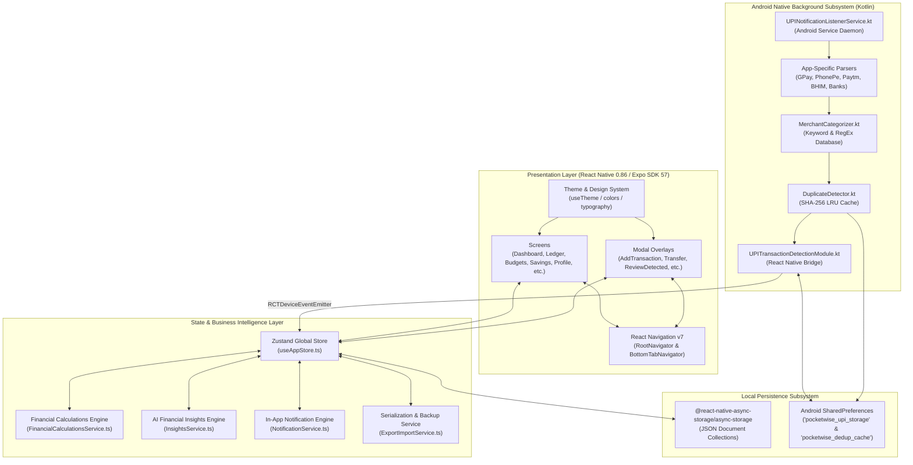
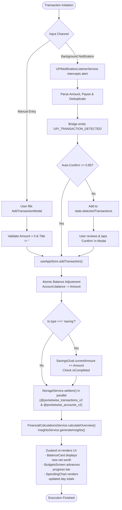
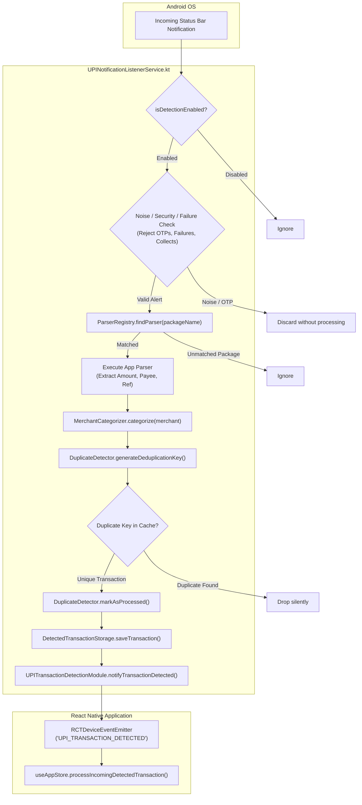
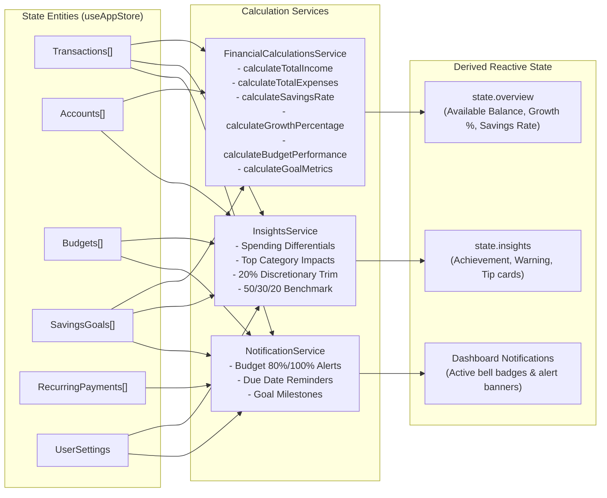
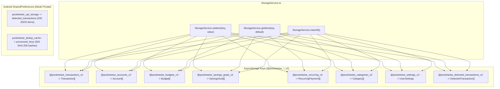

# PocketWise — Complete System Architecture & Technical Diagrams

This document consolidates the complete system architecture, data flow pipelines, hardware bridges, and interaction diagrams for the PocketWise application.

---

## 1. Master System Architecture

PocketWise is engineered with a **Two-Tier Offline-First Client Architecture** comprising a cross-platform React Native presentation layer and an autonomous Android native background processing engine.

---

## 2. Real-Time Data Flow: End-to-End Transaction Cycle

The following diagram tracks how a transaction travels from user touch (or background notification) through atomic validation, balance updating, disk persistence, and visual recalculation.

---

## 3. Android Native Notification Detection Subsystem

The diagram below details the internal execution pipeline of the Android native service running in the background.

---

## 4. Derived Financial Calculations & State Architecture

---

## 5. Persistence Subsystem & Key Topology

